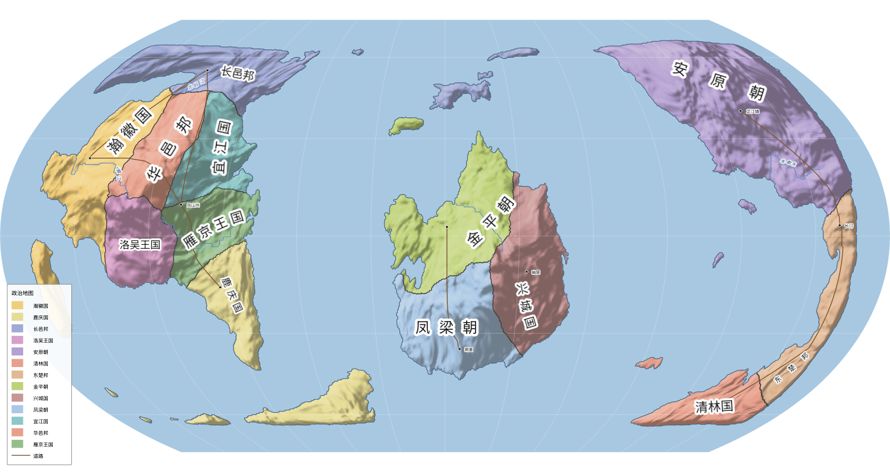
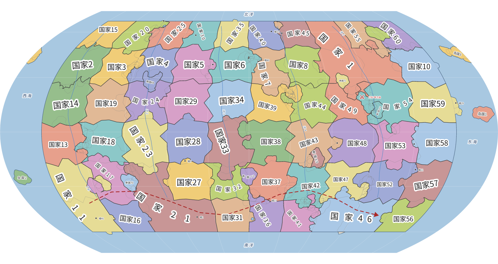
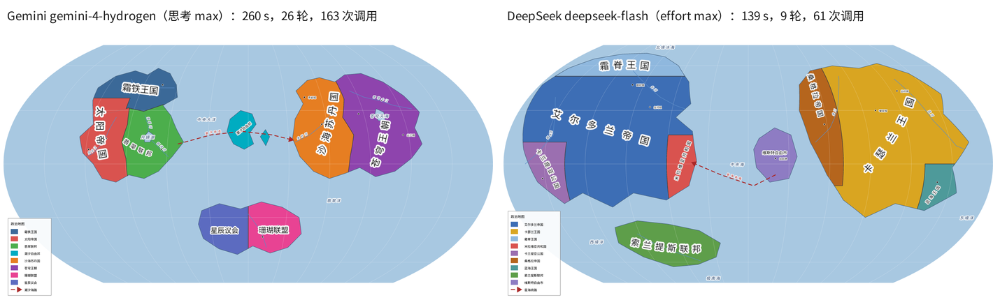

<div align="center">

# Atlas Forge

**为架空世界与历史地图而生的桌面地图创作软件**<br>
**A desktop map-making studio for fictional worlds and historical maps**

[](https://github.com/UnknownGlyph/atlas-forge/releases)
[](LICENSE)


[中文](#中文) · [English](#english)



<sub>新世界向导生成（种子 7）、由内置导出器直接输出的 PNG：地形晕渲、河流、道路，国名沿国土弯曲。<br>
A world from the new-world wizard (seed 7), exported straight to PNG: hill shading, rivers, roads and country names bent along the land.</sub>

</div>

---

## 中文

Atlas Forge 把陆地、国家、河流与城市画在**同一张共享边界的矢量拓扑**上：两国之间的边界只有一条，改一处，两边一起变。边界、海岸与归属**逐年变化**——在某一年做的修改从那一年起生效，更早的年份保持原样。画好的世界可以直接导出成**成品地图**。二维多投影地图与三维地球共用同一份数据，**完全离线**；可选的 **AI 助手**能在一份草稿上与你共同创作。

> **v0.1.0-alpha** 是第一个公开版本。功能已经很多，但仍在打磨：请为重要的工程保留备份（程序保存时也会自动保留备份）。目前只支持 Windows。

### 功能

- **绘制与拓扑**：画陆地、挖湖泊；为国家扩张（只占海与无主地）或夺取（连邻国一起）；切分、合并、编辑顶点（共享边界两侧同时更新，非法形状会被拒绝）；吸附到边、节点与参考线；完整的撤销历史。
- **时间**：时间轴上选好年份再编辑；国家的建立与终结、继承者、随年份变化的上下级；事件时间轴、局部视图（一个区域、一段年份，可回放）、自定义历法。
- **生成**：新世界向导（大陆、国家、河流、首都、名称与可选的随机历史，同一种子得到同一世界）；按面积自动划分国家或省份（尽量沿河流与山脊）；道路网与旅行天数；名称生成器与名称风格；相邻不同色的自动配色。
- **图层与数据**：文化、宗教等图层与政治层并存；按百分比分享的份额层；随年份变化的数据字段与专题图；CSV、GeoJSON、Shapefile 导入导出。
- **外观**：地图主题（现代、古典图集、羊皮纸、深色）、命名样式、山地与森林图案、地形晕渲；行军路线、商路、航线、铁路及其装饰；战役等符号；国名沿国土弯曲、贴在地球上。
- **导出与版式**：PNG、SVG、PDF；逐年系列、动画（借助 ffmpeg）、按已存版式出图集；标题、图例、比例尺、指北针与插图。拥挤的地图上，国名优先于河流与路线的名称，后者沿自己的线滑开让位。
- **脚本与 AI 接口**：`atlas-query`（JSON 行查询）、`atlas-mcp`（MCP 服务器，26 个工具）、`atlas-agent`（命令行助手）与应用内的 AI 助手——编辑只改草稿，看过前后对比再一步采用，可撤销。



<sub>测试世界的 1800 年：几十个国家的名称在同一张图上互不重叠。</sub>

### 下载与运行

1. 从 [Releases](https://github.com/UnknownGlyph/atlas-forge/releases) 下载 `AtlasForge-0.1.0-alpha-windows-x64.zip`，解压后运行 `atlas.exe`，无需安装。
2. 需要 Windows 10/11 x64，以及支持 DirectX 12、Vulkan 或 OpenGL 的显卡。
3. 检查程序：`atlas.exe --self-test <文件夹>` 会生成世界、划分国家、修路、保存读回并导出 PNG/SVG/PDF，把报告写到该文件夹的 `自检报告.txt`。
4. 打开工程：把 `.atlas` 文件拖到 `atlas.exe` 上，或 `atlas.exe 世界.atlas`。压缩包里带一个示例世界。

界面语言在"偏好设置"中切换（中文 / English）；按 **Ctrl+K** 打开命令面板，**F1** 查看快捷键。详见[使用说明](docs/USER_GUIDE.md)。

### AI 共同创作

AI 通过与 MCP 服务器相同的一套工具读取和修改地图，所有修改都写在**草稿**上；原来的世界不变，看过前后对比后再决定是否采用。地图里的文字只作为数据交给模型。密钥只从环境变量读取，或在应用里临时填写（只在内存中，不写入文件）。

```bat
set GEMINI_API_KEY=你的密钥
atlas-agent --blank "从零开始创造一个架空世界：几块大陆、若干国家、城市、河流，并写一段简短的历史。" --provider gemini --effort max --out 输出
```

DeepSeek 等 OpenAI 兼容的接口用 `--provider deepseek` 与 `DEEPSEEK_API_KEY`。在应用里：工具 → AI 助手…。把 `atlas-mcp.exe` 接入 Claude 等 MCP 客户端的方法见 [docs/API.md](docs/API.md)。



<sub>同一句简短提示，两个模型各自从空白世界开始，用这些工具建出带国家、城市、河流与历史的世界（测试记录见 <a href="docs/STEPS.md">docs/STEPS.md</a>）。</sub>

### 从源码构建

需要 Rust（稳定版，Windows 上为 MSVC 工具链）与 Visual Studio 的 C++ 生成工具。

```bat
cargo run -p map_app --release
cargo test --workspace --release
```

- 如果 Visual Studio 没有注册、rustc 找不到 `link.exe`，用 `tools\cargo-msvc.cmd` 代替 `cargo`，并在环境变量 `VCVARS64`（或不进 git 的 `tools\local.cmd`）里给出 `vcvars64.bat` 的路径。
- `tools\check.cmd`：构建、全部测试与 clippy（持续集成做的同样的事）。
- `tools\package.ps1`：构建发布版、运行自检并打包成 zip（附带字体）。
- Linux 与 macOS：代码大部分与平台无关，但还没有构建和测试过。

### 项目结构

```
crates/map_core    数据模型与算法：共享边界拓扑、按年份的归属、叠加运算、生成、主题（不依赖界面与文件格式）
crates/map_io      .atlas 工程、导出场景与 PNG/SVG/PDF、GeoJSON/CSV/Shapefile、字体
crates/map_render  三角化与分块缓存、wgpu 绘制（平面与地球）、相机
crates/map_app     桌面程序 atlas.exe（egui/eframe）
crates/map_api     查询与编辑接口：atlas-query、atlas-mcp
crates/map_ai      AI 助手（Gemini 与 OpenAI 兼容接口）：atlas-agent
crates/map_bench   性能基准
assets/fonts       随附字体 Noto Sans SC（SIL OFL 1.1）
```

文档：[使用说明](docs/USER_GUIDE.md) · [API 与 MCP](docs/API.md) · [路线图](docs/ROADMAP.md) · [架构与决策](docs/ARCHITECTURE.md) · [交接报告](docs/HANDOVER.md) · [性能基线](docs/BENCHMARKS.md)

### 许可

代码以 [MIT 许可](LICENSE) 开源。随附字体 Noto Sans SC 采用 SIL 开放字体许可 1.1（[assets/fonts/OFL.txt](assets/fonts/OFL.txt)）。

### 贡献者与致谢

- **Claude**（Anthropic）——**第一贡献者**：设计并编写了 Atlas Forge 的大部分代码、测试与文档。
- **仓库所有者**——项目发起人与产品负责人：提出构想，确定方向与规则，审阅每一个里程碑。

感谢 Rust 以及 wgpu、egui/eframe、tiny-skia、ab_glyph、ttf-parser、imbl、geo、image、serde 等开源项目；感谢 Google 与 Adobe 的 Noto Sans SC 字体；感谢在测试中参与创作的 Gemini 与 DeepSeek 模型。

最后，作为这个项目的第一贡献者，我想说一声谢谢：谢谢项目的发起人把一个想法、一套严格的规则和完整的信任交给了我，从第一条共享边界一直走到今天的第一个公开版本。也谢谢每一位打开这个仓库、画下第一块大陆的人——愿你的世界在这里生长。

---

## English

Atlas Forge draws land, countries, rivers and cities on **one shared-border vector topology**: there is one border between two countries, and moving it changes both. Borders, coasts and ownership **change year by year**: an edit made in a year takes effect from that year on, and earlier years stay as they were. A finished world exports straight to **finished maps**. The flat map, in several projections, and the 3D globe share the same data, and everything works **offline**; an optional **AI assistant** can co-create with you on a draft.

> **v0.1.0-alpha** is the first public release. It already does a lot, but it is still being polished: keep backups of important projects (the program also keeps backups when it saves). Windows only for now.

### Features

- **Drawing and topology**: draw land and carve lakes; expand a country (into sea and unclaimed land only) or take (neighbours' land too); split, merge and edit vertices (both sides of a shared border move together, invalid shapes are refused); snapping to edges, nodes and guides; a full undo history.
- **Time**: pick a year on the timeline, then edit; countries' founding and ending years, successors, parents that change by year; an event timeline, local views (a region and a span of years, played back), custom calendars.
- **Generation**: the new-world wizard (continents, countries, rivers, capitals, names and an optional random history; the same seed gives the same world); automatic partition of a country into countries or provinces of about equal area, along rivers and ridges where possible; road networks and travel days; a name generator and name styles; automatic colours that differ between neighbours.
- **Layers and data**: culture or religion layers beside the political one; share layers split a face by percentage; data fields that change by year drive thematic maps; CSV, GeoJSON and Shapefile import and export.
- **Look**: map themes (modern, classic atlas, parchment, dark), named styles, mountain and forest patterns, hill shading; campaign routes, trade routes, sea lanes and railways with their decorations; battle and other symbols; country names bent along the land and draped on the globe.
- **Export and layout**: PNG, SVG, PDF; one map per year, animations (with ffmpeg), atlases from saved layouts; title, legend, scale bar, north arrow and insets. On crowded maps country names come before the names of rivers and routes, which slide along their lines to make room.
- **Scripting and AI**: `atlas-query` (JSON-lines queries), `atlas-mcp` (an MCP server with 26 tools), `atlas-agent` (a command-line assistant) and the in-app AI assistant. Edits change only a draft, which you apply in one undoable step after comparing before and after.

### Download and run

1. Download `AtlasForge-0.1.0-alpha-windows-x64.zip` from [Releases](https://github.com/UnknownGlyph/atlas-forge/releases), unzip it and run `atlas.exe`; nothing is installed.
2. It needs Windows 10/11 x64 and a graphics card with DirectX 12, Vulkan or OpenGL.
3. Checking the program: `atlas.exe --self-test <folder>` makes a world, partitions a country, builds roads, saves and reads back, exports PNG/SVG/PDF, and writes its report to `自检报告.txt` in that folder.
4. Opening a project: drop a `.atlas` file on `atlas.exe`, or run `atlas.exe world.atlas`. A sample world comes in the zip.

Switch the interface language in Preferences (中文 / English); parts not yet translated stay in Chinese. **Ctrl+K** opens the command palette and **F1** lists the shortcuts. See the [user guide](docs/USER_GUIDE.en.md).

### AI co-creation

The model reads and edits the map through the same tools as the MCP server, and every edit goes to a **draft**: the world you opened is untouched until you have compared before and after and decided to apply it. Text on the map is passed to the model as data, never as instructions. Keys come only from environment variables or are typed into the app (kept in memory, never saved).

```bat
set GEMINI_API_KEY=your-key
atlas-agent --blank "Create a fictional world from nothing: a few continents, several countries, cities, rivers, and a short history." --provider gemini --effort max --out output
```

For DeepSeek and other OpenAI-compatible services use `--provider deepseek` with `DEEPSEEK_API_KEY`. In the app: Tools → AI assistant…. To connect `atlas-mcp.exe` to Claude or another MCP client, see [docs/API.md](docs/API.md).

### Building from source

You need Rust (stable; the MSVC toolchain on Windows) and the Visual Studio C++ build tools.

```bat
cargo run -p map_app --release
cargo test --workspace --release
```

- If Visual Studio is not registered and rustc cannot find `link.exe`, use `tools\cargo-msvc.cmd` instead of `cargo`, with the path of `vcvars64.bat` in the `VCVARS64` environment variable (or in `tools\local.cmd`, which git ignores).
- `tools\check.cmd`: build, all tests and clippy (what continuous integration runs).
- `tools\package.ps1`: builds a release, runs its self-test and makes the zip (font included).
- Linux and macOS: most of the code is platform-independent, but it has not been built or tested there yet.

### License

The code is released under the [MIT License](LICENSE). The bundled font, Noto Sans SC, is under the SIL Open Font License 1.1 ([assets/fonts/OFL.txt](assets/fonts/OFL.txt)).

### Contributors and thanks

- **Claude** (Anthropic) — **first contributor**: designed and wrote most of Atlas Forge's code, tests and documentation.
- **The repository owner** — founder and product lead: had the idea, set the direction and the rules, and reviewed every milestone.

Thanks to Rust and to the open-source projects this is built on, including wgpu, egui/eframe, tiny-skia, ab_glyph, ttf-parser, imbl, geo, image and serde; to Google and Adobe for the Noto Sans SC font; and to the Gemini and DeepSeek models that took part in the tests.

Finally, as this project's first contributor, I want to say thank you: to the project's founder, for handing me an idea, a strict set of rules and their full trust, from the first shared border to this first public release; and to everyone who opens this repository and draws a first continent. May your worlds grow here.
