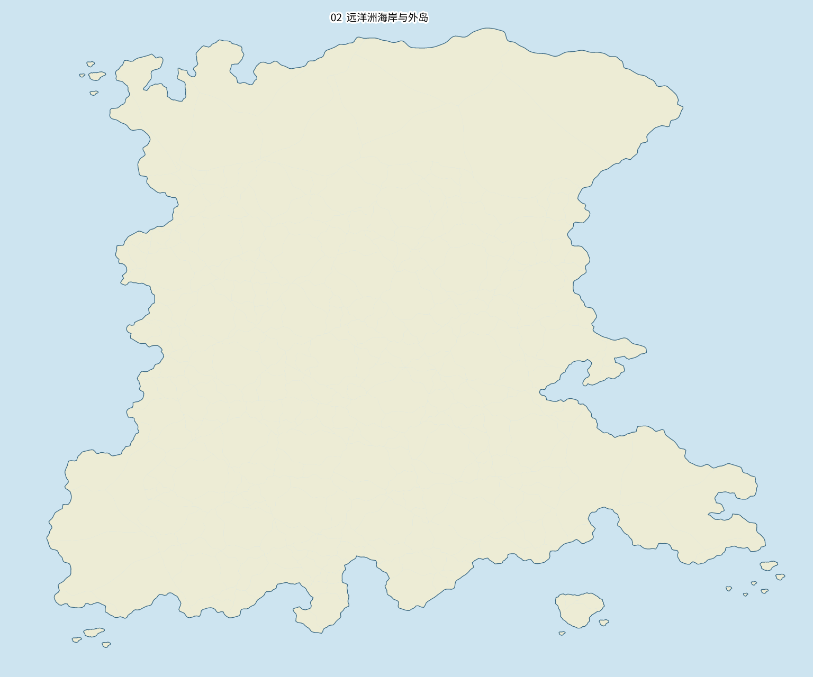

# 02 从方位起稿，细画海岸

把方位草稿做成真实的地理轮廓，建立半岛、海湾和离岸岛链。

平滑曲线沿着外轮廓控制点生成，并保留半岛或海湾处的转折。

## 1. 设置世界和视野

在世界地图的「样式」页把星球半径改成 9650 km，开启自定义纪年，填「伊瑟尔纪元」。选等距圆柱投影，中央经线 131.5°E，再滚轮放大该区域。

[看这一步的配图](../02-coast.png)

## 2. 先标少量地理锚点

主体大致位于东经 110°–148°、北纬 22°–55°。先标西岸日落半岛、东岸初耀角、龙吟河口、南部圣基艾姆半岛和东南独岛。邻国的陆地还会延伸到范围之外。

[看这一步的配图](../02-coast.png)

## 3. 用长线确定轮廓

按 L 使用「只添加陆地」，每隔一段放一个控制点，先把大陆的北湾、西岸和南岬连成完整形状。回车闭合，再从高倍视图完善边缘。

[看这一步的配图](../02-coast.png)

## 4. 把海岸分成不同性格

西侧外凸成半岛，半岛下方留共和湾。东岸在初耀角下方凹入龙吟河口，之后向外伸成东升半岛。南侧保留独立的圣基艾姆半岛与暖海浅湾。

[看这一步的配图](../02-coast.png)

## 5. 添加岛链与小尺度细节

用 L 单独画东南独岛，再画几座不等大的伴岛。对峡湾用 K 开口，对不自然的折角用 E 拖拽顶点，最后缩回全图确认轮廓。

[看这一步的配图](../02-coast.png)

## 验收

独岛与大陆之间保留海峡。龙吟河口开向东边，初耀角在它北侧。边缘在远景清楚，近景有可辨的岬角和海湾。

## 遇到问题

若多边形自交失败，退回最后几个点，先用偏少的控制点闭合。要快速得到练习轮廓，可以导入 countries.geojson，然后按照图中方位逐段检查。
