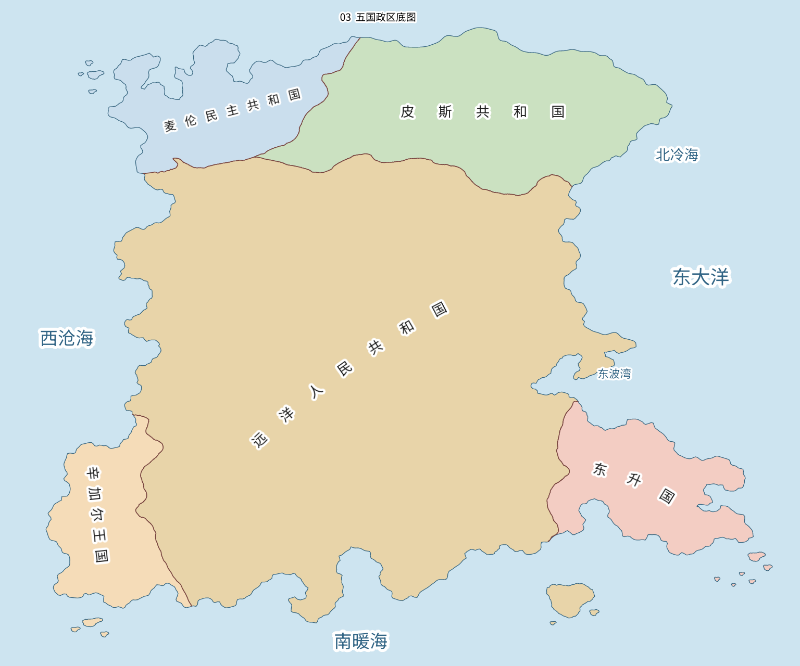

# 03 建立五国与共享国界

把一套海岸划分为七个国家，并检查它们的接壤关系。

七个主权实体使用独立底色。两国之间是一条可以共同编辑的边界。

## 1. 选择互斥的分区层

在右侧「国家」的分区层下拉框选择「政治归属」，添加远洋人民共和国及皮斯、麦伦、辛加尔、东升。先保存一个检查点。

[看这一步的配图](../03-countries.png)

## 2. 先定北边两个邻国

用 S 从大陆边缘切出麦伦和皮斯；麦伦靠西北海岸，皮斯在远洋北面。再切它们之间的国界。切分路径的两端都要落在已有边界。

[看这一步的配图](../03-countries.png)

## 3. 分配西部和东南

将西南沿海赋给辛加尔，给东升分配东部连接大陆的半岛和附近小岛。翠湾留在东南暖湾，科林斯留在西南丘陵的内陆一侧。

[看这一步的配图](../03-countries.png)

## 4. 为各国指定颜色

选中国家，调整属性面的颜色。同一套底色优先让相邻国家区分开。远洋用低饱和暖沙色，邻国用青绿、冷蓝、橙粉和灰紫。

[看这一步的配图](../03-countries.png)

## 5. 核对边界拓扑

选择「编辑 → 校验拓扑」。放大后按 E 拖动一段边界上的节点，观察两边一起变化，再 Ctrl+Z 撤销。也可用严格模式导入 countries.geojson 继续练习。

[看这一步的配图](../03-countries.png)

## 验收

政治层有五国，远洋居中。翠湾和科林斯可分别选中，东升与远洋有陆界，独岛归远洋。

## 遇到问题

导入矢量会生成新地图。先保存当前草稿，导入后检查星球半径及投影。若图块颜色相同，先检查是否选错分区层。
