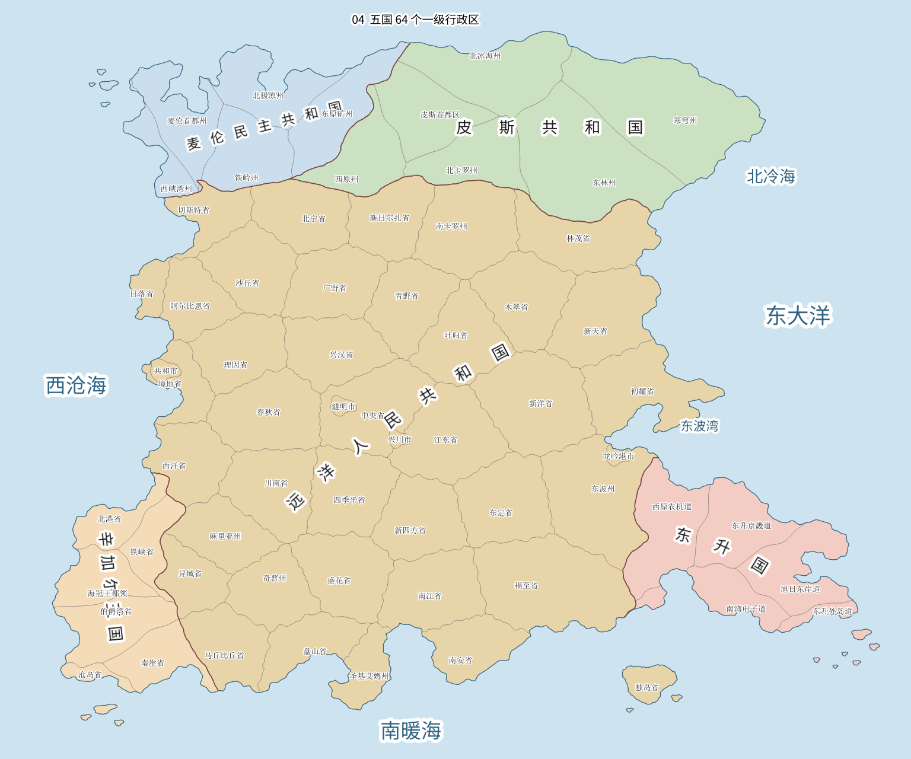

# 04 建立 42 个一级行政区

建立正确的从属关系，同时用分级字体区分国名、省级名和更低级的地名。

远洋 42 个、四邻国 22 个一级行政区使用共享轮廓，放大后可继续进入地、县级。

## 1. 先做一个手绘省份

选中远洋，点「绘制省份」，在它的直属陆地上圈出一个范围，再按回车。边界会裁到上级直属地块，鼠标越过邻国不会改领土。

[看这一步的配图](../04-provinces.png)

## 2. 导入全部行政区轮廓

保存草稿后另开工程，以严格模式导入 provinces.geojson。在国家列表新建「远洋人民共和国」，先不拿领土画笔重涂边界。

[看这一步的配图](../04-provinces.png)

## 3. 批量建立从属关系

选中新建的远洋国，打开「批量设为下级…」。搜索编号 YY-，点「全选筛选结果」，确认已选 42 个后应用。不要把六个邻国选进去。

[看这一步的配图](../04-provinces.png)

## 4. 清点组成和资料

在远洋下展开省级列表，核对 4 直辖市、5 个保留州名的省级区和 33 省。在数据表读设定面积、人口与必要 GDP，几何面积用于绘图区大小核对。

[看这一步的配图](../04-provinces.png)

## 5. 检查分级字体和缩放

打开「样式 → 行政区分级字体」。缩小检查国名，放大到省界出现，再观察宋体省名。可以试在某省下建一个下级地区，放大查看较小的楷体县区名。

[看这一步的配图](../04-provinces.png)

## 验收

远洋拥有 42 个一级行政区，皮斯 6 个、辛加尔 6 个、麦伦 5 个、东升 5 个。切换上级可核对每个下级的归属。

## 遇到问题

如果筛选为零，确认导入的是 provinces.geojson 而不是五国总图。如果编辑旧项目仍是统一字形，在样式页启用分级字体。
