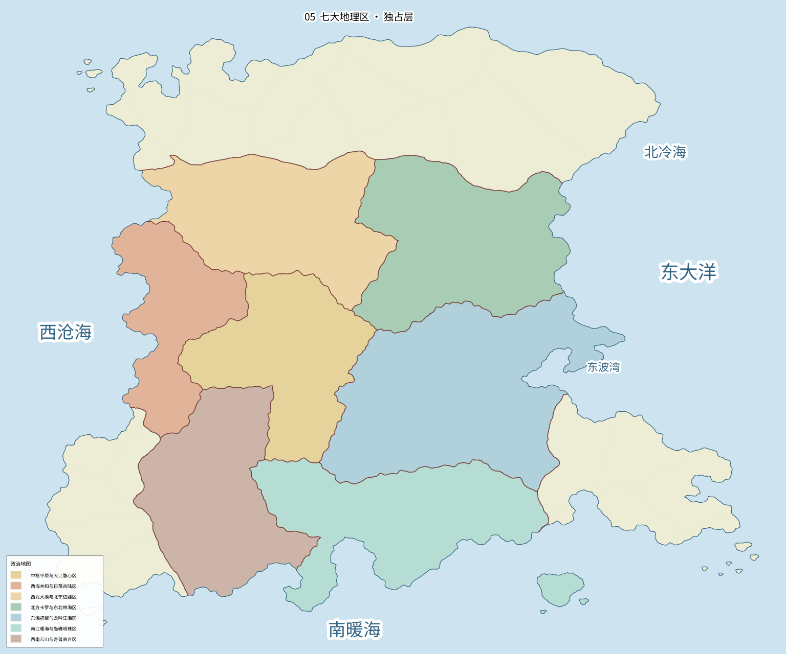

# 05 在独占层布置七大地理区

保留政治行政区，同时为区域分析和专题输出建立七区。

同一个地块能在政治层归于某省，在地理区层归于另一个分区。

## 1. 创建地理区独占层

从「国家 → 分区层」新建独占层，输入「七大地理区」并回车。暂时观察两张图的配色如何切换。

[看这一步的配图](../05-regions.png)

## 2. 加入七个区域单位

参考地理志，依次添加中枢、西海、西北、北方、东海、南部、西南各区。给七区设置方便比较的相邻色。

[看这一步的配图](../05-regions.png)

## 3. 用政治边界作参考

在地理区层的「叠加显示」选政治归属。用 B 把每个行政区的地块分配给对应地理区，资料表的 group 列可用来复核。

[看这一步的配图](../05-regions.png)

## 4. 检查离岛和边疆

把独岛归南江暖海与岛礁明珠区。南卡罗州与林茂等归北方卡罗与东北林海区。分配漏掉的岛屿与分离地块。

[看这一步的配图](../05-regions.png)

## 5. 切换并出一张专题图

切回政治归属核对仍是 42 个单位。再切到七区，分别试一下带图例的导出。

[看这一步的配图](../05-regions.png)

## 验收

切换两个分区层时，拓扑轮廓相同。政治行政区的从属关系、地理区填色各自完整。

## 遇到问题

如果把整个国家涂到一个地理区，先撤销。使用单击选择要分配的地块，确认填充范围后再操作。
