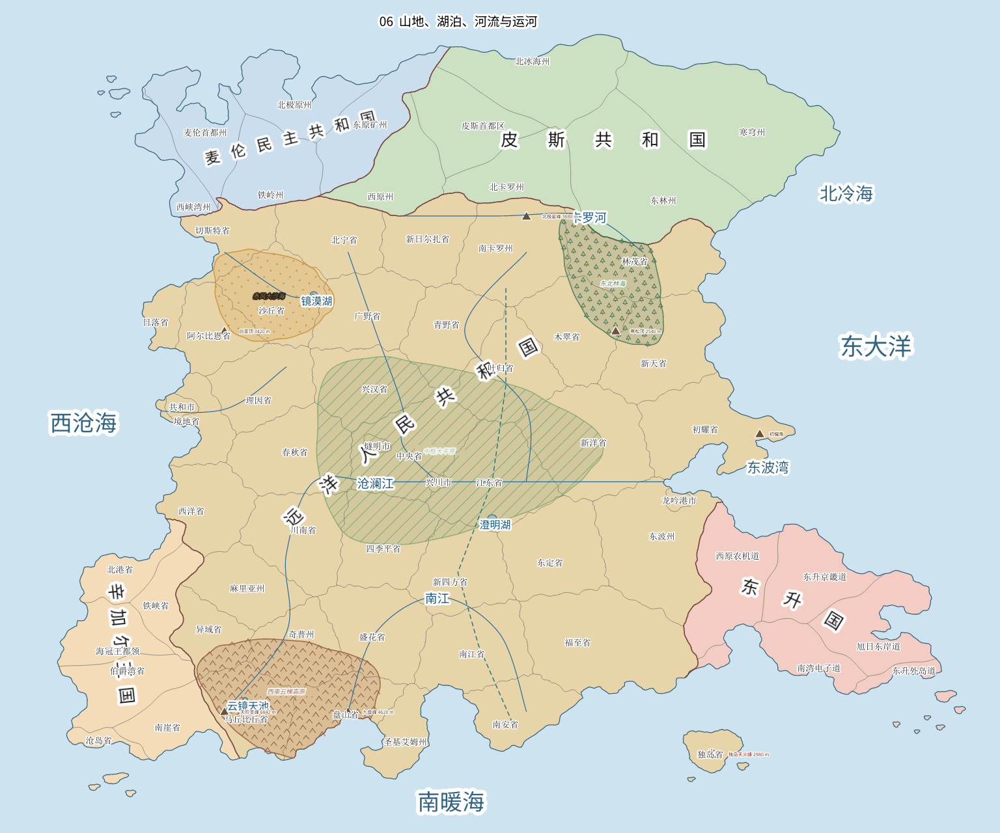

# 06 画山脊、水系和运河

从地貌解释河流为什么这样流，建立可以分别检查的自然要素图层。

西南高原、西北沙海、东北林海和中枢平原使用不同纹理。河道在保留关键汇流点的前提下细画。

## 1. 先摆地貌骨架

在「图层」建立「地貌」组。用 H 圈西南云梯高原、西北赤风大沙海、东北林海与中枢平原，分别设置山地、点纹、森林、浅色斜纹。

[看这一步的配图](../06-water.png)

## 2. 给关键山峰放符号

用 Y 标天阶圣峰、九盘峰、白垩顶和独岛火山，字号不要盖过同处的行政区。沿地形把空间留给向下游的河谷。

[看这一步的配图](../06-water.png)

## 3. 从源头向海绘干流

用 R 选「河流」，从马丘比丘高原出发，经川南、兴川交汇区和江东，向龙吟港入海。主要折点放在转向和汇流处，弯道再补控制点。

[看这一步的配图](../06-water.png)

## 4. 接支流并开湖

以吸附后的河道点作为北汉江与青叶江的汇流终点。用 K 画澄明湖、镜漠湖和云镜天池。湖名与线名移到不盖住岸线的位置。

[看这一步的配图](../06-water.png)

## 5. 添加运河并分层检查

将共兴南北大运河画成青蓝虚线，从北方穿过中枢并向南部延伸。隐藏地貌组查看水系，再恢复全天图。

[看这一步的配图](../06-water.png)

## 验收

河流流向下游。龙吟河口线在海岸收尾，支流汇入干流。不同的自然要素可以单独显示或隐藏。

## 遇到问题

若一段支流断开，放大检查吸附提示。城市、海岸和水系各在一层时，可暂时关闭其他图层解决选不中的问题。
