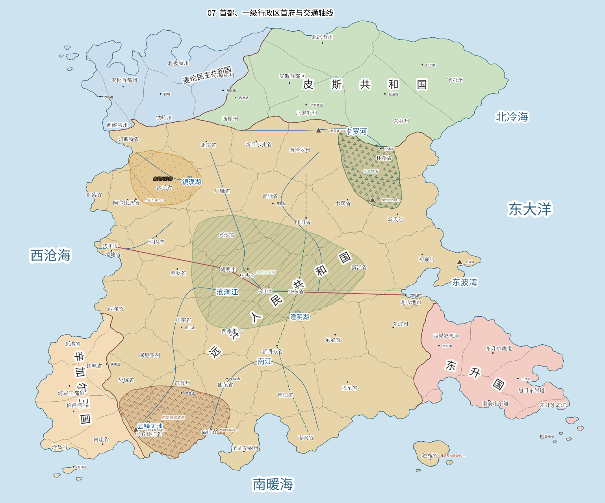

# 07 安放首都、省会和交通

让城市层级和交通网络和行政、河口、山地位置对应。

燧明为全国首都。主要驻地用较小的无衬线字，和邻近的宋体行政区名称区别开。

## 1. 放置四个直辖市驻地

用 C 在燧明、共和、兴川、龙吟港的位置落点。确认是在相应行政区内，再在属性中命名，避免城市归属偏到隔壁省。

[看这一步的配图](../07-cities.png)

## 2. 设置国家首都

选远洋国，在「首都」下拉框选燧明市。给首都加醒目标记，并留出附近河道及城市名的空间。

[看这一步的配图](../07-cities.png)

## 3. 安放省级驻地

按练习数据依次放置各省会。在每个省份属性里选对应城市为首府。地图缩小仍应先看到首都，放大后能检查其他驻地。

[看这一步的配图](../07-cities.png)

## 4. 画通横向交通线

按 P 或 R 以线路模式连接共和、燧明、兴川与龙吟港。在线路面板设置颜色、线宽和图例，用同样方法补地区支线。

[看这一步的配图](../07-cities.png)

## 5. 进行标注校对

打开分级字体，在两个缩放级别看同一处。优先为国名和首都留位置，移开与市县重叠的地貌文字。

[看这一步的配图](../07-cities.png)

## 验收

城市在正确行政区内，首都、主要驻地和行政区三个层次可读。交通线经过几个关键枢纽，河流线没有被它完全盖住。

## 遇到问题

如果当前缩放看不见地方城市，滚轮放大，或暂时关掉「按缩放显示细节」。调整城市落点时，检查城市详情中的归属。
