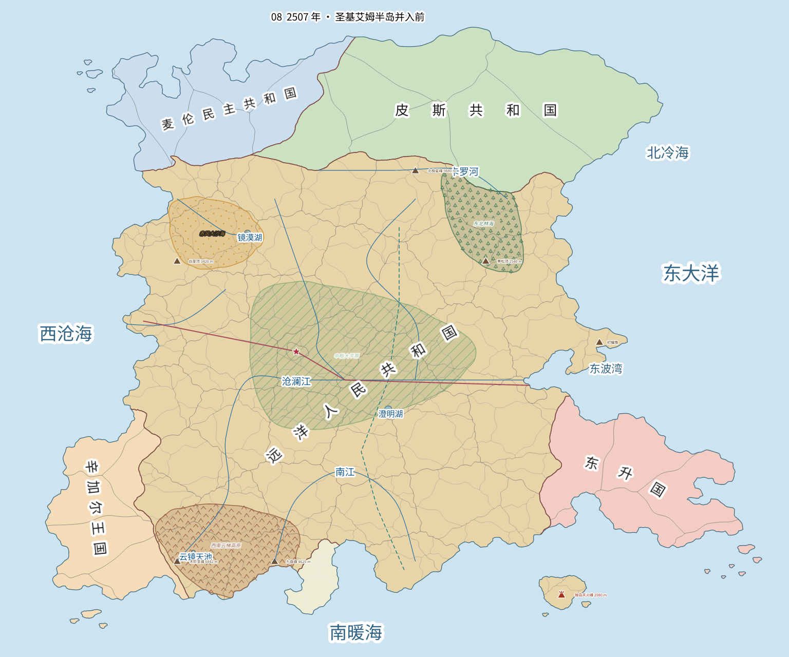

# 08 制作半岛并入的前后年份

每次改归属都能在明确的年份重放，并带有可打开的事件。

2897 年成品保留五国；2507 年视图用浅色无归属显示当时尚未并入的半岛。

## 1. 先存未经时间编辑的副本

把半岛练习另存一份，预备出现误选年份时恢复。隔离要操作的地块，避免用填充桶改变整片国土。

[看这一步的配图](../08-history.png)

## 2. 先画并入前疆域

进入 2507 年，选领土画笔，清空半岛地块的归属作为练习底本。用同一套共享几何表示并入前状态。

[看这一步的配图](../08-history.png)

## 3. 从 2508 年改归属

打开时间轴，在年份框填 2508。用 B 选圣基艾姆州，分配半岛有关地块，确认上级为远洋。

[看这一步的配图](../08-history.png)

## 4. 补事件和存在年份

在「时间 → 事件时间线」新建公投并入事件。给原共和国设置终止年 2507，给新州设置成立年 2508。还可记录 2699 年建国和 2742 年行政制度变更。

[看这一步的配图](../08-history.png)

## 5. 逐年复核

在 2507 与 2508 年切换，对照国界和国家列表。最后回到 2897。

[看这一步的配图](../08-history.png)

## 验收

同一半岛在 2507 年和 2508 年分别属于不同实体。现代都城、省级数据和其他邻国没有被本次编辑重分配。

## 遇到问题

若 2507 和 2508 看起来相同，检查时间轴是否打开，并在选定年份后重做归属变更。
