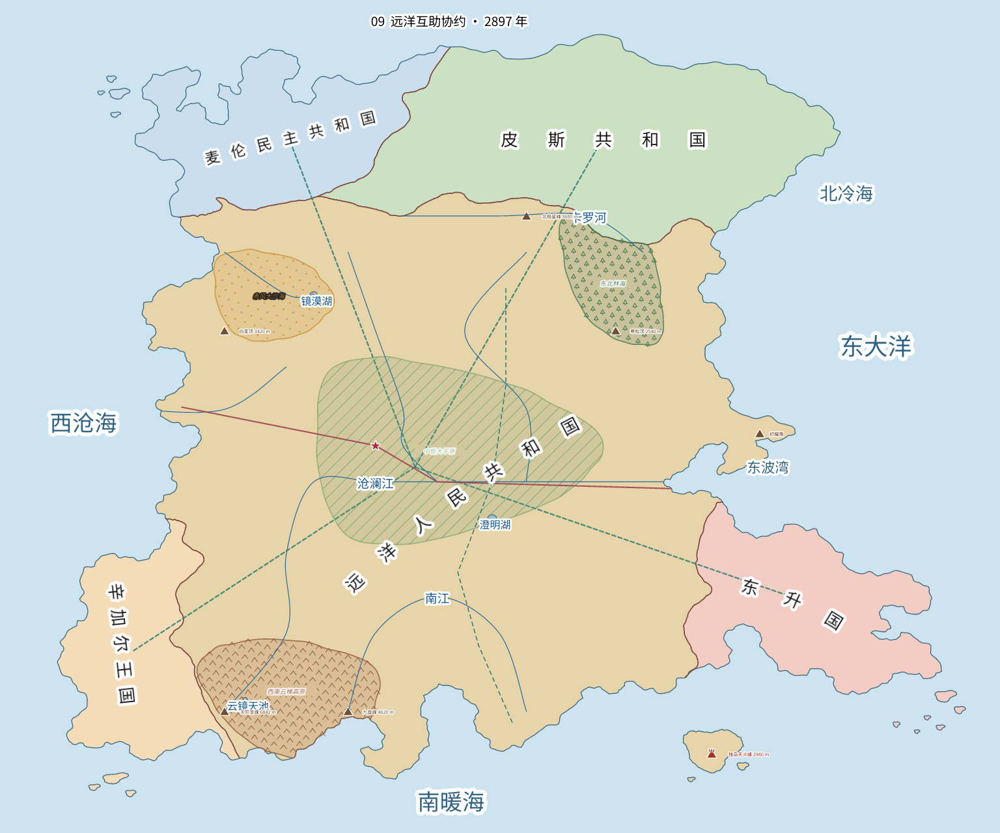

# 09 录入远洋互助协约

建立可按年份查阅的五国协约，并关联缔结事件。

关系连线是一张外交关系示意图。参与国的领土仍按政治层绘制。

## 1. 选到示例年代

在时间轴选择 2897 年。确认远洋、皮斯、辛加尔、麦伦和东升都存在，并且有独立的主权单位。

[看这一步的配图](../09-diplomacy.png)

## 2. 新建一条多边关系

打开「时间 → 外交关系…」，点「新建关系或协约」。填远洋互助协约，类型选同盟。

[看这一步的配图](../09-diplomacy.png)

## 3. 勾选成员和年代

勾选五国，起始年填 2766。保留无结束年状态。翠湾与科林斯不加入这一条记录。

[看这一步的配图](../09-diplomacy.png)

## 4. 添加说明与事件

加入经济、能源与防务合作说明，从事件列表选 2766 年的协约缔结事件。点击「保存关系」。

[看这一步的配图](../09-diplomacy.png)

## 5. 查看连线再回查历史

打开「地图连线」，从 2897 年切到 2750 年。协约应在前一个视图可见，在后一个视图按年份筛掉。

[看这一步的配图](../09-diplomacy.png)

## 验收

协约是一条包含五国的多边记录，可从记录打开缔结事件。两个中立邻国仍在政治地图上。

## 遇到问题

若选不到参与方，检查当前单位是否在政治归属层。若全年份都有该记录，关闭「浏览所有年份」，再核对起始年。
