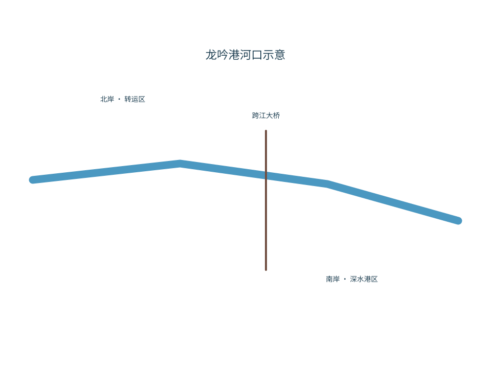

# 10 给龙吟港关联详图与文档

从地图对象进入自己的白纸详图，并用文档作为第二个入口。

港口示意画板有独立绘制内容。它展示的是河口结构和设施位置。

## 1. 选对地图对象

回到 2897 年，放大东海岸。在新区界出现后选龙吟港市行政区。打开「视图 → 世界资料库」检查标题。

[看这一步的配图](../10-board.png)

## 2. 建立地方画板

创建「新建关联画板」，命名为「龙吟港河口示意」，进入。先画一条宽蓝线路，再用不同样式画跨江桥和两岸道路。

[看这一步的配图](../10-board.png)

## 3. 分层补说明

用 T 补北岸转运区与南岸深水港区的名称。把桥、河道和说明分别编组。调到全画布时应能在同一视图读清。

[看这一步的配图](../10-board.png)

## 4. 附上文档与截图

从龙吟港新建关联文档，写简短港口介绍。将画板截图插入文档，用「内部链接」选择该画板。

[看这一步的配图](../10-board.png)

## 5. 检查两个返回方向

从地图对象的关联入口进入画板，再从文档打开同一画板。用顶部导航返回世界地图并保存。

[看这一步的配图](../10-board.png)

## 验收

两个入口指向同一张画板。重开工程后，文字、图片和链接都可访问。

## 遇到问题

单击选到上级国家时继续放大，或从行政区列表选龙吟港。居中画板和切换地理地图是两个独立视图。
