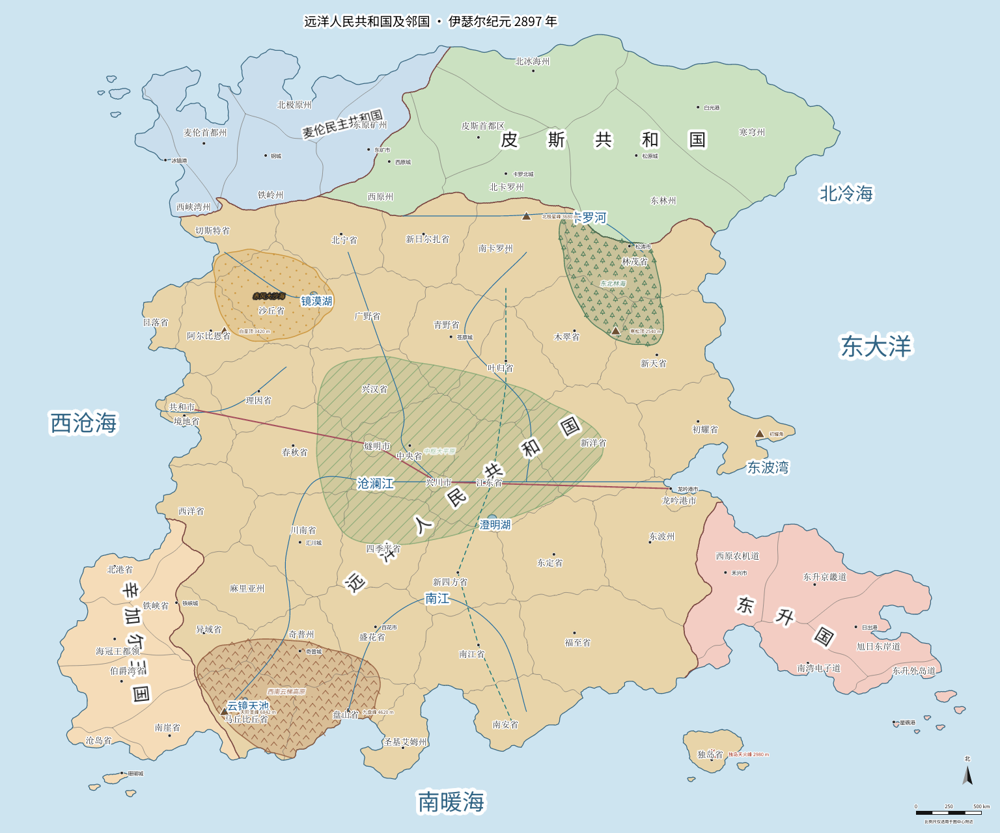

# 11 复核地图并完成导出

交付一份保存好的工程，以及一张可供展示的最终地图。

远洋与六个邻国的终稿。图上轮廓、气候地貌与线网用于示范架空地图工作流。

## 1. 先校验内容

切到 2897 年，运行「编辑 → 校验拓扑」。用 F 聚焦远洋后调整视野，让离岛、东方半岛和两侧海面都留在成品里。

[看这一步的配图](../11-atlas.png)

## 2. 安排分级字体和层次

在样式里开启行政区分级字体。缩放检查国名、各省、城市和海名。隐藏不必要的导引标记，给首都和海岸留白。

[看这一步的配图](../11-atlas.png)

## 3. 整理版式

打开「版式视图」，设置标题、伊瑟尔纪年和指北针。将图例和比例尺放靠外的海面或页边，避开关键地理锚点。

[看这一步的配图](../11-atlas.png)

## 4. 分别导出预览与发布文件

按 Ctrl+E，若同属地块接缝太密，可启用对应的隐藏选项。先导出 PNG 检查，再按需要导出 SVG 或 PDF。

[看这一步的配图](../11-atlas.png)

## 5. 保存后再打开一次

关闭和重开 .atlas 文件。核对行政区数量、七区层、历史归属、外交协约和龙吟港文档。

[看这一步的配图](../11-atlas.png)

## 验收

展示图有明晰的海岸和国界，字体能区分各级名字。打开另存的工程能恢复图层、年份和关联内容。

## 遇到问题

如果导出只剩全世界的小角落，在导出范围选当前二维视图，或回版式调整范围。引用设定统计时读取对应字段。
