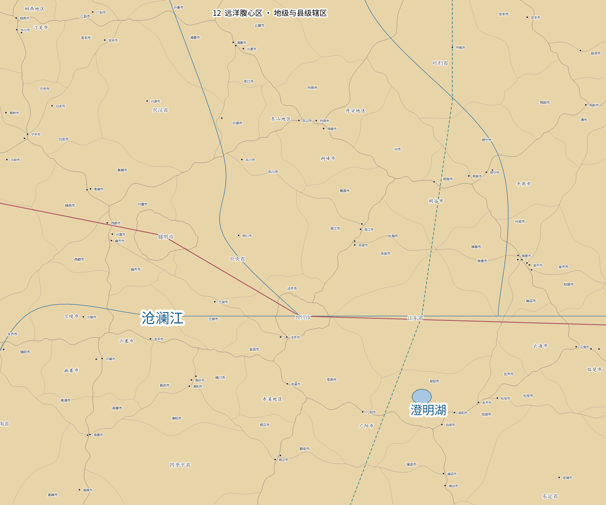

# 12 细绘地级市、地区与县级市

在同一套行政边界上，从国家逐级划到县级，并给每一级落下可搜索的城市点。

腹心区局部图。粗细线区分省界、地级界与县界；黑点对应可独立编辑的驻地。

## 1. 先确认省的直属用地

打开成品，选择远洋人民共和国，在下级列表打开中央省并按 F。缩放后再点需要继续分区的地块，检查右侧标题与上级。

[看这一步的配图](../12-districts.png)

## 2. 沿河谷和交通轴定驻地

先找河流交汇、沿海入海口和交通轴节点，再安排地级市中心。山区幅员较大的辖区可以使用「地区」，把中心放在便于连通的盆地。

[看这一步的配图](../12-districts.png)

## 3. 用两种方式建立地级辖区

从省的属性点「绘制下级地区」，跨过本省边界的部分不会被划入。若已有地块合适，可点「用选中地块建下级地区」。改名后按回车提交。

[看这一步的配图](../12-districts.png)

## 4. 在地级辖区内继续分县

选中刚建的地级市，使用「自动划分下级地区…」预览数量与边界。可以仅采纳拓扑，再用切分、合并或改画边界沿山河微调。给地级市保留驻地周围的一部分直属陆地。

[看这一步的配图](../12-districts.png)

## 5. 添加驻地点并设置首府

按 C 在辖区内部添加城市点，再在辖区属性设置首府。县级市的多边形用于管辖范围，驻地点用于标记和数据；两者可以同名。

[看这一步的配图](../12-districts.png)

## 6. 检查细节的出现顺序

在「视图」开启「按缩放显示细节」。用滚轮从国界依次进入省、地、县，按 F 定位所选辖区。切换三维核对同一串边界。

[看这一步的配图](../12-districts.png)

## 7. 读懂城市数量

成品包含 4 个远洋直辖市的驻地点、70 个地级市驻地、20 个地区驻地、234 个县级市驻地和 22 个四邻国一级驻地。城市下拉列表按名称或编号查找。

[看这一步的配图](../12-districts.png)

## 验收

新城市点位于自己的辖区。跨县移动共享边界，两侧同时贴合。辖区与城市点能分别选择。

## 遇到问题

下级划不进去时先确认选择了正确上级，还要查看是否已经被其他下级占用。用撤销回到划分前再调整。
