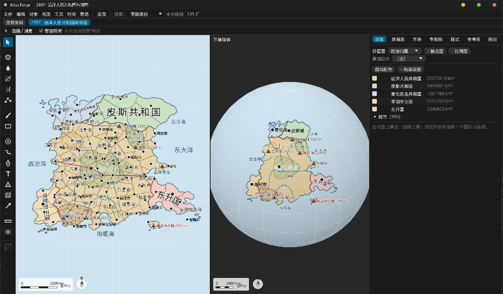

# 13 控制二维、三维与显示层级

从全洲定位到任意县级辖区，在二维和球面之间维持方位。

二维与三维分屏展示同一份工程。右侧标签切换国家、数据、样式与图层。

## 1. 复位和选中定位

打开教程成品；默认以远洋洲为中心。按 Home 恢复打开视角。点选一个国家或辖区，按 F 把它放大到视野。

[看这一步的配图](../13-navigation.png)

## 2. 平移、缩放和旋转

选用「选择／浏览」。按住空格拖动二维地图，滚轮以指针为中心缩放。三维拖动会旋转，松手后略有惯性，重新拖动可接管。

[看这一步的配图](../13-navigation.png)

## 3. 切换投影与中央经线

在「视图」选择二维、三维或分屏。二维尝试等距圆柱、米勒和 Equal Earth，对比高纬外形。在中央经线输入 131.5°，把投影接缝放到所画大陆的对侧。

[看这一步的配图](../13-navigation.png)

## 4. 控制地图上的解释元素

可在「视图」开关经纬网、比例尺与指北针。在「样式」关闭城市与地名，观察海岸和政治结构，再打开分级字体恢复阅读。

[看这一步的配图](../13-navigation.png)

## 5. 核对不同尺度的对象

打开按缩放显示细节，先选国家，再放大选省以及更深层的辖区。抽查城市是否在所属县市范围内；小尺度在球体旋转停止后会恢复详细标注。

[看这一步的配图](../13-navigation.png)

## 6. 用命令面板快速跳转

按 Ctrl+K 搜索「测量」「世界资料库」或「校验拓扑」。用 F1 查看当前快捷键。键盘焦点在名称输入框时先提交再触发快捷键。

[看这一步的配图](../13-navigation.png)

## 验收

独岛保持在东南近海。平面与球面都能定位到同一个港口，返回全图后国界不跨投影边缘。

## 遇到问题

画板没有经纬投影；从世界资料库打开地理地图画板或返回世界地图再切换三维。
