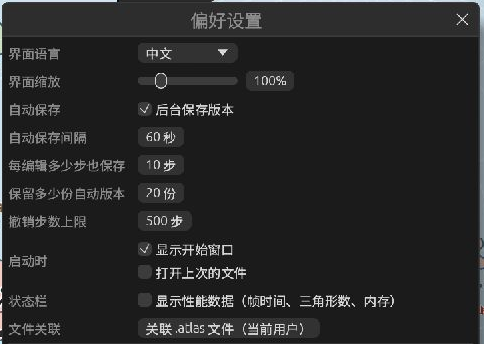

# 14 设置保存点、自动保存和撤销

能对不同阶段精确回退，同时保留当前已保存的 .atlas。

磁盘版本面板列出命名保存点与自动版本，分别标示。

## 1. 先给主工程一个名字

用 Ctrl+Shift+S 将练习另存为新文件。在大规模导入、分区或换主题前应建立阶段保存点。

[看这一步的配图](../14-checkpoints.png)

## 2. 创建一个有意义的保存点

选择「文件 → 保存点与自动保存…」，输入「五国国界确认」，然后点击「创建保存点」。保存点可记录当时的未保存工作。

[看这一步的配图](../14-checkpoints.png)

## 3. 按编辑节奏配置自动保存

在同一窗口点「自动保存设置」。例如时间 60 秒、每 5 步、保留 20 份。任一条件满足时，未保存的已提交改动才会生成一个后台版本。编辑步数填 0 时只按时间。

[看这一步的配图](../14-preferences.png)

## 4. 恢复并使用撤销试跑

修改练习工程的国家名称，选择以前的保存点，在确认区点「确认」。用 Ctrl+Z 回到恢复前；Ctrl+Y 重新恢复。最后按 Ctrl+S 才更新主工程。

[看这一步的配图](../14-restore.png)

## 5. 比较三类历史

「视图 → 历史记录」查看编辑过程；保存点及自动版本留在同名 .atlas.history 文件夹；主文件正式保存时原内容轮转为 .bak1 至 .bak3。

[看这一步的配图](../14-autosave.png)

## 6. 携带工程或找回未保存稿

移动项目时同时复制 .atlas 文件和匹配的 .atlas.history 文件夹。若程序意外退出，启动时先用恢复提示接回工作，再另存或保存。

[看这一步的配图](../14-checkpoints.png)

## 验收

主文件保存前后可与恢复版本分别对照。自动轮转到上限时，命名保存点仍在列表。

## 遇到问题

列表为空时检查是否打开了原文件或换过文件名；另存出的新项目拥有自己的版本目录。
