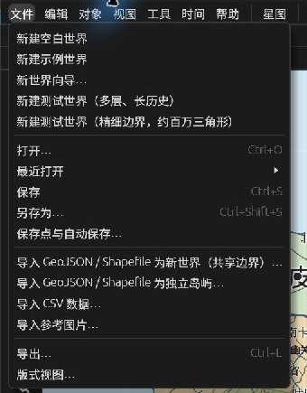

# 15 导入边界、数据和参考底图

掌握共享边界导入、独立岛屿导入、按编号接合 CSV 和参考图配准。

文件菜单将地理、数据和参考图导入分开。

## 1. 导入已经拼好的共同边界

在练习副本选择「文件 → 导入 GeoJSON / Shapefile 为新世界（共享边界）…」。使用 countries.geojson 建五国，或导入 provinces.geojson 单独研究省级边界。

[看这一步的配图](../15-imports.png)

## 2. 决定如何处理贴合误差

含相邻国或省的图用共享边界模式。检查导入报告里的重叠、断点和空洞，合理设置修复距离。单个新岛示例可用独立岛屿模式加入当前世界。

[看这一步的配图](../15-imports.png)

## 3. 用编号接合属性

CSV 第一行用 code、可选 name 和 year，再加人口等字段列。导入前检查编号与「数据表」相符。取消创建未匹配实体，先查看未匹配清单。

[看这一步的配图](../15-imports.png)

## 4. 给扫描图定位

导入参考图片后按 A 选择配准工具。在参考图与地图之间标若干相同地理点，如海岬、河口和岛尖。分开分布的点比挤在一处稳定。

[看这一步的配图](../15-imports.png)

## 5. 边描边核对误差

调低参考图透明度，先勾描跨区域的大轮廓，再检查局部比例。配准失败时核查错点、经度和投影，完成后把底图隐藏以核验纯线形。

[看这一步的配图](../15-imports.png)

## 6. 还原和修补

在副本撤销一次导入，确认能回到此前状态。再导入并运行拓扑检查。需要重修时保留修复报告、源文件和生成前保存点。

[看这一步的配图](../15-imports.png)

## 验收

导入面两侧共享一条边；CSV 的匹配数符合预期；参考图远近都有定位点。

## 遇到问题

用于制版导出的统计 CSV 是阅读版。如需再次导入，使用 Atlas 导出的字段表或把列名改成对应字段键。
