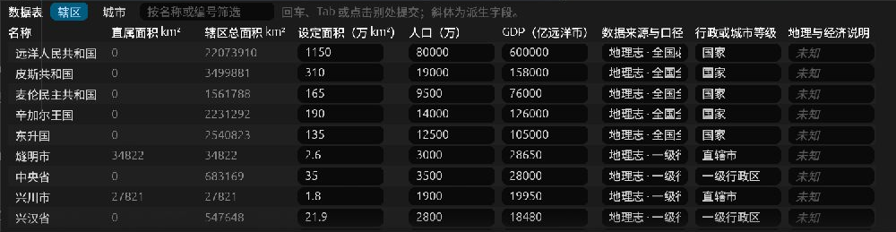
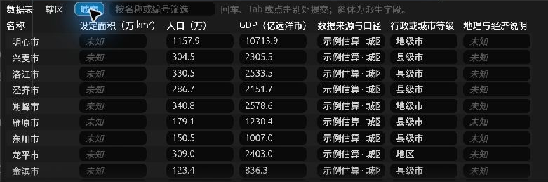

# 16 填入人口与 GDP，制作专题图

用带年份和来源的数值支撑国情、辖区和城市对照，再将数值做成地图。

数据表可在地图下面展开。示范中地理志原值与估算字段都有来源说明。

## 1. 读清单位和年份

切到 2897 年。五国国家数据和远洋 42 个一级行政区使用地理志数值。远洋是必要 GDP，四邻国是地理志的全口径 GDP。人口单位为万，GDP 为亿远洋币。

[看这一步的配图](../16-data.png)

## 2. 加一列你要表达的属性

点「字段」建立数值键，例如 population_10k；另建文本键存来源。在数据表选「辖区」或「城市」，按名称或编号筛选，编辑后按回车提交。

[看这一步的配图](../16-cities.png)

## 3. 区分辖区合计与城区

辖区人口包含该辖区全部下级。城市点记录城区估算，不能和所在辖区直接相加。直属面积与含下级的总面积是几何结果；「设定面积」保留资料数字。

[看这一步的配图](../16-data.png)

## 4. 给不同年份录不同值

在 2897 年录首份统计，再切到下一年改一条。到「字段」选择历史值的使用方式，比较精确年份、沿用、基础值或数值插值。

[看这一步的配图](../16-data.png)

## 5. 用表达式派生专题变量

建立只读公式字段，用已有数值键计算人均 GDP。若使用 GDP 的亿单位除以人口的万单位，结果是万远洋币/人。先处理空值和零人口。

[看这一步的配图](../16-data.png)

## 6. 选择专题图层和图例

到「专题图」选人口、人均 GDP 或分类字段，设置配色和分级。比较两个年份时复用同一分级范围和图例，避免颜色差被误认为数量增长。

[看这一步的配图](../16-data.png)

## 7. 导出并对账

导出当前年份 CSV，核对远洋 42 区合计与全国设定。将版式的专题图导出为 PNG 或 PDF，并注明口径、计量单位和年份。

[看这一步的配图](../16-data.png)

## 验收

统计表的数据年份、字段单位、地理来源和专题图图例一致。新录入的城市值能在表中筛选找到。

## 遇到问题

如果改动写到了所有年份，先撤销并打开按年份查看／编辑，再选年份重填。
