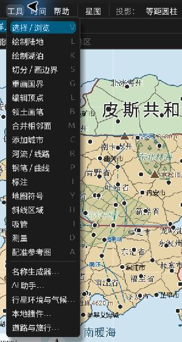

# 17 组织线路、标注、符号和要素图层

用独立要素图层建立水系、交通、地貌、标注四套可单独导出的表现。

工具菜单含几何编辑、文字符号、测量、辅助创作与自动化入口。

## 1. 画线和曲线

用 R 建线路或河流，每次点一个锚点后回车完成。用 P 的钢笔模式做连续曲线，沿河谷和山坡走向摆控制点，避免回折。

[看这一步的配图](../17-tools.png)

## 2. 让交通和自然水系区分

给陆运使用铁路装饰或虚线，给航线留足水面。用「道路与旅行…」预览城间道路，比较用测量工具估出的直线与实际路线天数。

[看这一步的配图](../17-tools.png)

## 3. 做图标、纹理和标注

按 Y 放山峰、首都等符号，按 H 画森林或山地图案区域，按 T 建地图文字；用标注工具调整国名位置和角度。文字与行政对象的名称分开维护。

[看这一步的配图](../17-tools.png)

## 4. 建立共用样式

给线路、符号、区域、文字创建具名样式，后续统一改外观。用 I 吸管复制风格；同类要素也可通过对象菜单粘贴样式。

[看这一步的配图](../17-tools.png)

## 5. 分组、锁定和排序

框选同类对象，Ctrl+G 放入「水系」或「交通」。用眼睛图标隐藏，用锁保护。拖动或使用层控制调整前后顺序和透明度。

[看这一步的配图](../17-tools.png)

## 6. 对齐和重排装饰

多选比例尺附近的辅助标注或示意符号，从「对象」对齐或等距分布。把道路、山脊等有地理位置的要素留在原地。

[看这一步的配图](../17-tools.png)

## 7. 最后检查局部坐标

用测量工具比较首都和两个港口的距离。分屏检查同一要素的接缝、遮挡和拾取，分别导出自然图与交通图。

[看这一步的配图](../17-tools.png)

## 验收

单独隐藏交通层时海岸与政治归属仍在。相同样式的符号可以统一修改，已锁定的层仍显示。

## 遇到问题

要素图层管理线、区、符号和文字。要改变多个国家各自的陆地归属，切换政治或其他分区层处理。
