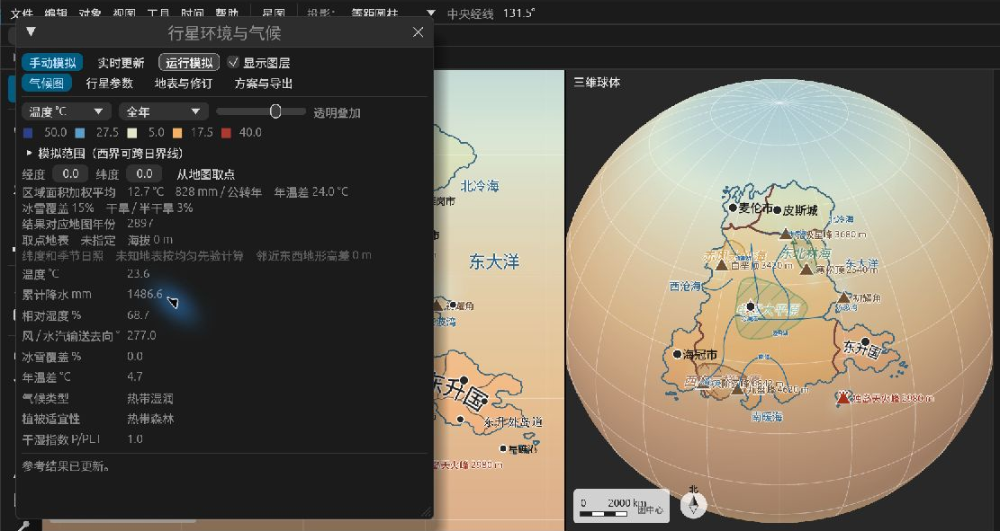
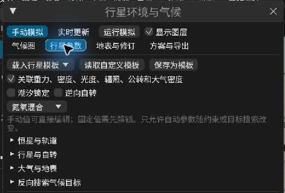

# 18 从基础气候到人工修订

演练空白世界的纬向气候、五国图局部雨影差异和创造性的修订。

在分屏中运行一次模拟后，二维和球形地图显示年度温度参考。

## 1. 空图先运行一次

新建空白世界，在「工具 → 行星环境与气候…」选择手动和标准地球模板，点运行。在全年温度层比较两个纬度；未定海陆区域由均匀背景条件估算。

[看这一步的配图](../18-climate.png)

## 2. 按项目修改行星

进「行星参数」，选择标准地球、保留重力、冰封、干旱、海洋或潮汐锁定等模板之一。改倾角看季节变化；保持重力时固定 g，只把质量设自动再改半径。

[看这一步的配图](../18-planet.png)

## 3. 学习物理联动与目标搜索

固定目标辐照并把距离设为自动，改变光度。尝试用平均温度或降水作为反向目标。面板报冲突时检查固定、手动、自动的分配，再选择可解的组合。

[看这一步的配图](../18-planet.png)

## 4. 把地形纳入参考

打开五国练习图，把模拟范围框在远洋洲。指定海拔、水体、林地或冰雪，切换降水、风、年温差和植被参考。比较山脉两侧及近海内陆。

[看这一步的配图](../18-climate.png)

## 5. 对比实时与手动

保持手动，改一段海岸，观察结果保留；按运行后才刷新。切到实时，再加小岛或改表面条件，等编辑停止后检查自动更新。

[看这一步的配图](../18-climate.png)

## 6. 在指定地点修订或固定

从地图点击取点，在「地表与修订」选择作用半径。给指定月份或年度设置数值，固定一个量或全部量，再次模拟确认所选值保留。

[看这一步的配图](../18-climate.png)

## 7. 留存两个方案并导出

分别保存标准和潮汐锁定两份结果。对比均温与降水，并从「方案与导出」把样图输出为 PNG、把逐月值输出为 CSV。

[看这一步的配图](../18-climate.png)

## 验收

方案能够切换，地图可继续编辑，手动固定点保留。局部范围以外保持透明。

## 遇到问题

网格当前是 3.75°。小岛及狭窄河谷变化可能落在同一格，适合用来推敲世界设定。

[气候模型、单位、预设和修订说明](../../CLIMATE.md)
