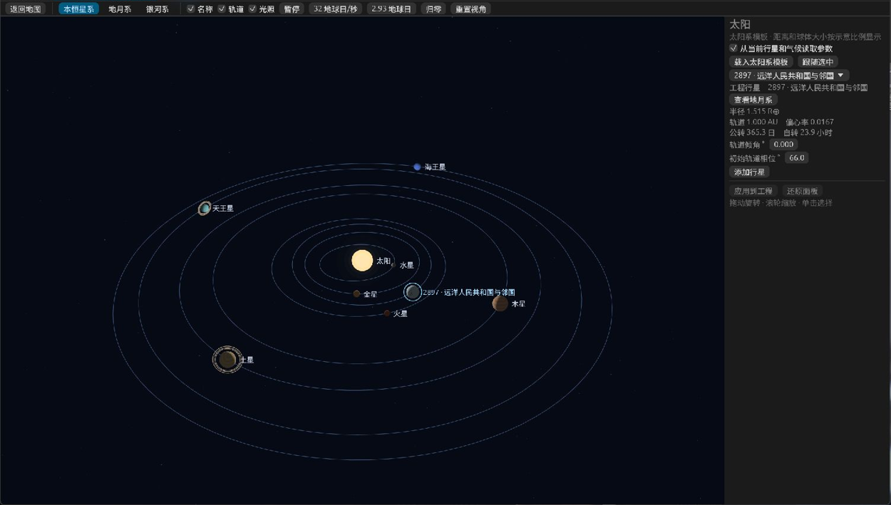
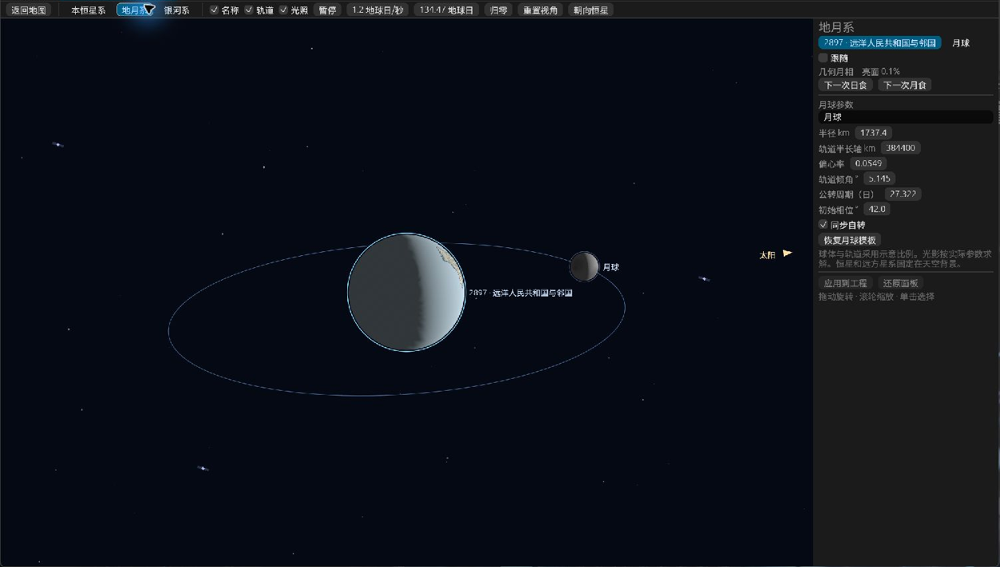
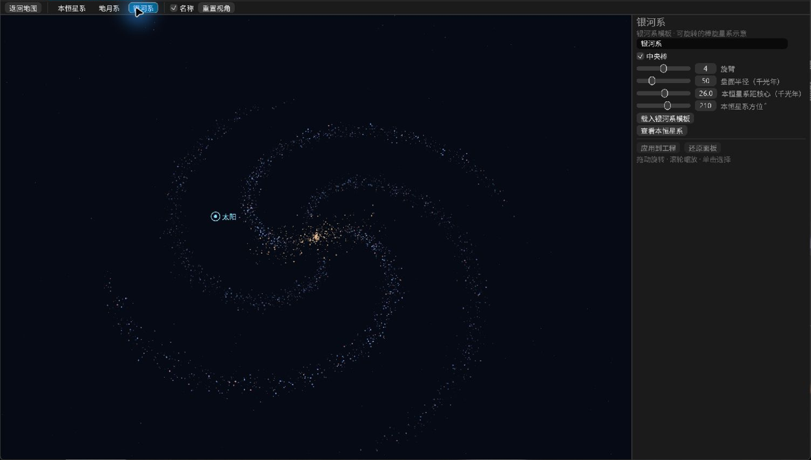

# 19 用星图设定本恒星系、月球和银河

安排恒星系与月球的时间和光照，并把工程行星放到星系中。

太阳系模板以工程行星替代地球，保留可运行的其余轨道。

## 1. 先用太阳系模板

点顶栏「星图」，确认「本恒星系」。暂停，看工程行星和其他天体的轨道。关闭名称或轨道显示可检查纯光照。

[看这一步的配图](../19-stars.png)

## 2. 让轨道运行并比较参数

改变时间速度。选中一个天体，看轨道半径、偏心率、倾角和自转。打开「从当前行星和气候读取参数」以继承工程参数。

[看这一步的配图](../19-stars.png)

## 3. 旋转和跟随选中对象

拖动空处旋转，滚轮缩放，侧栏选星球后使用跟随。随时用重置视角恢复。

[看这一步的配图](../19-stars.png)

## 4. 查看地月系和方向标

切到「地月系」，开光照，观察球面昼夜以及月球明暗。用「朝向恒星」在背景找到恒星，切换下一次日食或月食。

[看这一步的配图](../19-lunar.png)

## 5. 配置银河系视图

点击「银河系」，改变旋臂数和本恒星系距核心的位置。点击高亮的本恒星系返回系统，比较大尺度与局部视角。

[看这一步的配图](../19-galaxy.png)

## 6. 应用并重开工程验证

如果想保留星图参数，切回相关面板点「应用到工程」，再保存 .atlas。Esc 或「返回地图」继续绘制。

[看这一步的配图](../19-stars.png)

## 验收

三个星图入口都可回到地图，工程行星的海陆来自当前地图。能找出恒星方向并观察日食或月食模拟。

## 遇到问题

空间大小与轨道距离采用示意比例。设置月球后，使用当前版本或更新版本读取工程。
