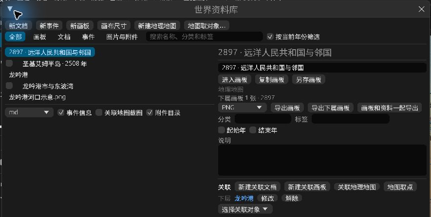
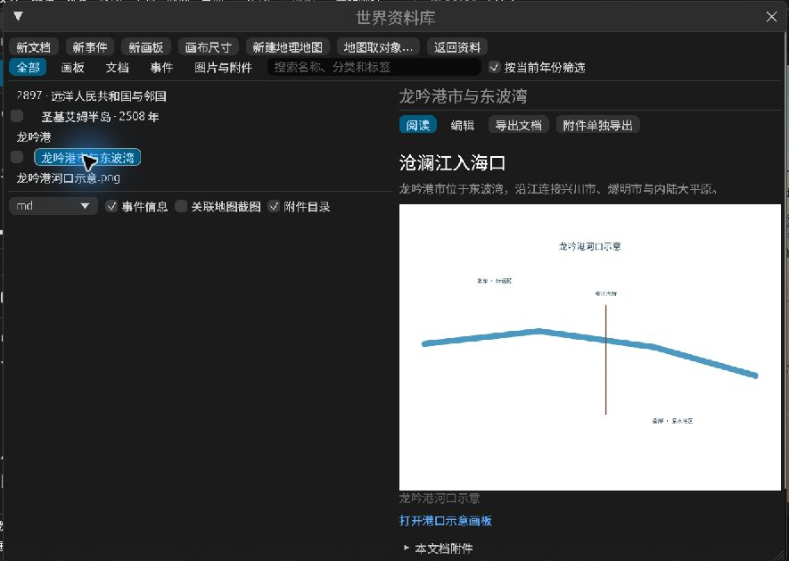

# 20 将地图、事件和文档编成资料库

建立一个可导航、带随文图片并能批量导出的资料体系。

世界资料库显示文档、事件、画板与附件，可筛选和跳转。

## 1. 从事件创建两个时间节点

用「新事件」建立港口建设或半岛并入，设置年份或区间，添加背景，再按当前年份过滤列表。

[看这一步的配图](../20-library.png)

## 2. 建立地理地图和白纸画板

「新画板」适合白纸港图。「新建地理地图」用于需要经纬度、投影和政治层的时期地图。给每张独立画板起名并设定精度。

[看这一步的配图](../20-library.png)

## 3. 写一个可独立阅读的文档

新建龙吟港文档，填名称、分类、标签与年份；编辑 标题、列表、表格，插入现有附件或导入图片，再切到阅读预览。

[看这一步的配图](../20-document.png)

## 4. 从文档链接到地图与事件

使用资料库生成的内部链接打开画板或事件。再从画板侧栏建立返回资料的关系。允许用同一个画板关联多个对象，检查向上导航与非层级跳转。

[看这一步的配图](../20-document.png)

## 5. 附加到地图上的国家或地点

在资料库点「地图取对象…」，选择要素或位置。为地点新增文档和画板关系。通过列表的「修改」「解除」调整关系；解除后可重新建立。

[看这一步的配图](../20-library.png)

## 6. 选择独立输出

在文档读页导出 TXT、Markdown、HTML、DOCX 或 PDF。按需选事件信息、地图截图和附件目录；批量选择几篇可分别导出或合并。

[看这一步的配图](../20-library.png)

## 7. 对照多层与时间设定

从世界图进入国家、港区与专题图，逐级返回。需要同步时用画板的时间联动选项。为不同年份建立引用或用独立版本。

[看这一步的配图](../20-library.png)

## 验收

从地图能进入图文和详情画板，再返回根地图。文档图片、关联、时间和附件在另存并重开后可用。

## 遇到问题

需要多个对象引用同一画板时，选「关联」并使用已有画板。独立画板有自己的图层和保存内容。

[资料库导航、格式及导出说明](../../WORLD_BOOK.md)
