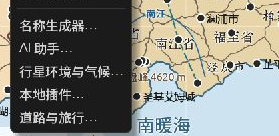

# 21 使用 AI 助手、本地脚本和插件

同一份副本分别用在线模型草稿、纯本地脚本和声明式插件试写属性。

工具菜单提供 AI 助手和本地插件，脚本可以独立在终端运行。

## 1. 配置合适的模型接口

在「工具 → AI 助手…」选择提供方、模型和服务地址。支持预设提供方、OpenAI 兼容接口与 Anthropic 接口。可仅用本地命令行完成后续练习。

[看这一步的配图](../21-automation.png)

## 2. 先问地图上的已知事实

让助手列出 2897 年远洋一级行政区的字段缺失情况，只查数据。确认模型引用的年份、层和实体和地图一致。

[看这一步的配图](../21-automation.png)

## 3. 预览草稿后采用

让助手新增一个示例政策事件或调整本地草稿中的地图标签。查看改动清单或前后预览，选择采用或丢弃。采用后可用 Ctrl+Z。

[看这一步的配图](../21-automation.png)

## 4. 从脚本检查地图

在解压目录使用 atlas-script.exe。给一份 .atlas 传入 world.summary 和 checks.run 请求。读懂 JSON 的 ok 和 result；再用 context.year 查 2897 的数值。

[看这一步的配图](../21-automation.png)

## 5. 离线批量编辑属性

用 edit.add_field 建数值字段、edit.set_value 按编号录值、edit.set_visibility 开关城市或图层。用 edit.import_table 传入 CSV 文本；检查未匹配行，再用 --out 给草稿另存。

[看这一步的配图](../21-automation.png)

## 6. 试跑示例插件

在「本地插件」打开示例清单，输入城市名和坐标，查看执行结果，最终采用或丢弃。编写时从示例复制材料，用参数定义和请求列表表达流程。

[看这一步的配图](../21-automation.png)

## 7. 接入支持 MCP 的客户端

将 atlas-mcp.exe 与工程路径配置成 stdio 服务。先列工具，再试查数据和预览；保存草稿在明确的新路径进行。

[看这一步的配图](../21-automation.png)

## 验收

脚本可以离线完成一次字段录入；插件能预演；在线助手的编辑经查看才应用。本地原工程文件保持已保存值。

## 遇到问题

见包内 API.md 与 PLUGINS.md。服务不可用时，可用 atlas-query.exe 或 atlas-script.exe 本地做资料检查。

## 本地脚本练习

将以下内容保存为 UTF-8 编码的 `练习.json`，在解压后的 Atlas Forge 文件夹中运行。输出工程适合直接在软件中打开。

~~~json
[
  {"op":"checks.run","context":{"year":2897}},
  {"op":"edit.add_field","args":{"key":"draft_note","name":"编图备注","kind":"text"}},
  {"op":"edit.set_value","context":{"year":2897},"args":{"entity":{"code":"YY"},"key":"draft_note","value":"已核对五国省级行政区"}},
  {"op":"edit.set_visibility","args":{"labels":true,"cities":true}}
]
~~~

~~~powershell
.\atlas-script.exe .\tutorial\yuanyang.atlas --file .\练习.json --out .\远洋脚本练习.atlas
~~~

[请求格式与全部操作](../../API.md) · [本地插件编写说明](../../PLUGINS.md)
