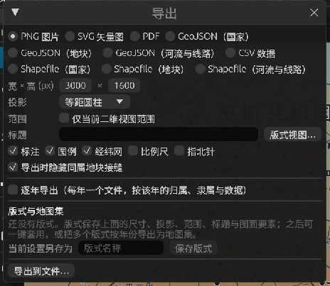

# 22 稽核边界、安排版式与发布

把可编辑工程、定稿、历史图和数据表整理成能交接的文件。

定稿预览以地理全图为主，地图集可另放详图和年份页。

## 1. 运行结构检查

在「编辑」运行「校验拓扑」。跨分类地块请先在历史层核对归属；确保五个政治实体各有边界、首都和已知数据。可用 checks.run 保存机器可读的检查结果。

[看这一步的配图](../22-review.png)

## 2. 检查派生小图

在不同缩放和投影核对参考图、独占层命名、城市层级、年份和图例。把不用于交付的参考图、施工线和气候叠图隐藏。

[看这一步的配图](../22-review.png)

## 3. 保存两套版式

打开「文件 → 版式视图…」，调整标题、图例、指北针和比例尺。加入局部插图框，另存成全洲页与腹心细图页。

[看这一步的配图](../22-review.png)

## 4. 输出单页、若干年份和地图集

从导出设置切 PNG、SVG、PDF。逐年导出选择变化年份或范围；GIF 用于短演示，MP4 需要 ffmpeg。地图集选用已保存的版式排列页序。

[看这一步的配图](../22-review.png)

## 5. 交付可重读的资料

另存 .atlas，保留版本文件夹与资料包。导出 CSV 与矢量边界并注明年份、单位和口径。解包到另一目录重新打开，核对工程与单独导出的文档。

[看这一步的配图](../22-review.png)

## 6. 交付前抽样复核

随机选几个不同层级的辖区及多个年份，核查行政隶属、城市位置、计算字段和资料内部链接。查看导出图中的文字避让，修正后更新最终命名保存点。

[看这一步的配图](../22-review.png)

## 验收

工程、地图图片、矢量、统计表都能独立打开并对应同一年。滚轮缩放与拖动在密集地图上仍然可用。

## 遇到问题

成图只显示当前指定投影、年份和图层。数据交换选 GeoJSON、Shapefile 或 CSV，并另存原工程以保留关联和样式。
