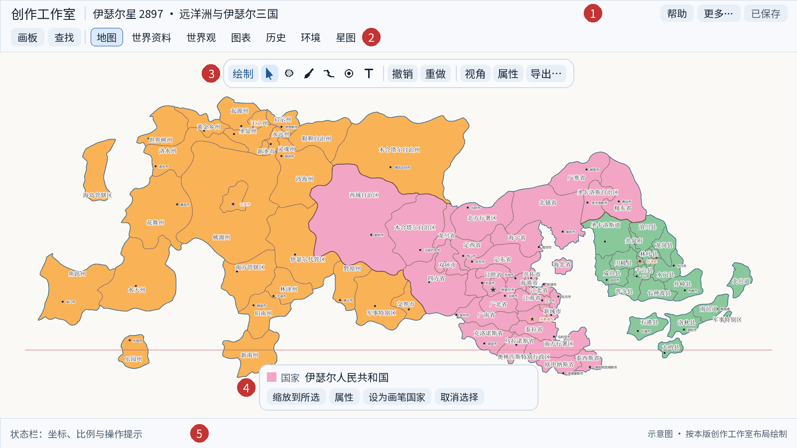

# 01 · 打开伊瑟尔三国，认识创作工作室

**目标**：打开伊瑟尔三国工程，认清创作工作室的五个区域，知道每类操作从哪里开始。

*示意图：① 项目名与保存 ② 页面 ③ 浮动工具条 ④ 选中卡片 ⑤ 状态栏。地图为工程导出的伊瑟尔三国行政详图。*

## 步骤

1. **进入创作工作室**

   在专业界面点顶栏的「创作工作室」，或按 Ctrl+Alt+F10。再按一次同一组键回到专业界面。两套界面共用同一份工程、撤销记录和保存状态。

2. **打开伊瑟尔三国工程**

   点右上角「帮助 → 打开伊瑟尔三国测试工程」。程序先使用偏好设置中的默认测试工程，再在工程目录下的 worlds/ithaer-2897/revised 中查找「伊瑟尔星2897_远洋洲与伊瑟尔三国.atlas」，都找不到时请你选择这个文件。工程以测试副本载入，原文件不会被覆盖。

3. **看顶部两行**

   第一行是工程名和右侧的太阳或月亮按钮、「帮助」「更多…」「保存」。太阳或月亮按钮在浅色与深色外观之间切换，「更多… → 外观」还可以选「跟随系统」。有未保存的修改时，名称后出现圆点，「保存」变为蓝色；保存后显示「已保存」。第二行左侧是「画板」「查找」，右侧是七个页面，鼠标停在页面名上会显示它管什么。

4. **认识浮动工具条**

   地图上方的工具条从左到右是：「绘制」菜单，常用工具图标（选择、绘制陆地、领土画笔、河流、城市、标注），撤销与重做，「视角」，「属性」和「导出…」。图标的提示里写着工具名、快捷键和用法。窗口较窄时，部分按钮收进「更多…」。

5. **用一次选中卡片**

   按 V 回到选择工具，在地图上单击粉色的伊瑟尔人民共和国。地图底部出现选中卡片，显示种类和名称，并提供「缩放到所选」「属性」「设为画笔国家」「取消选择」。

6. **另存为练习副本**

   点「更多… → 所有命令 → 文件 → 另存为…」，或按 Ctrl+Shift+S，把副本存成「伊瑟尔三国练习.atlas」。之后的章节都在这份副本上操作。

## 验收

标题显示「伊瑟尔星 2897 · 远洋洲与伊瑟尔三国」；选中伊瑟尔人民共和国后，底部卡片显示「国家 伊瑟尔人民共和国」；另存后名称后的圆点消失。

## 遇到问题

看不到工具条时，先确认当前在「地图」页。地图是空白并出现「开始创作」卡片，说明没有打开工程，可在卡片里点「打开伊瑟尔三国示例」。按 Home 可回到工程保存的打开视角。

---

[目录](../README.md) · [查找地点，控制视角 →](02-find.md)
