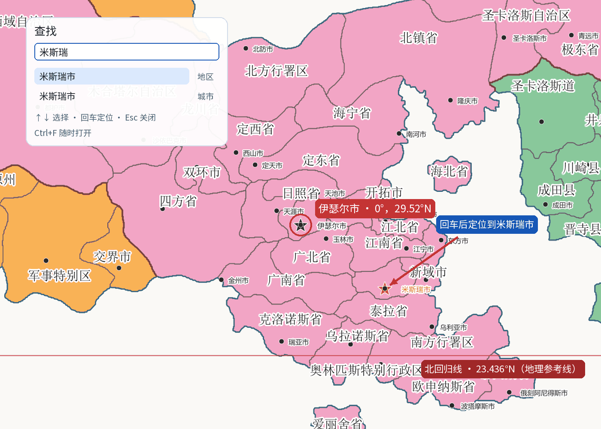

# 02 · 查找地点，控制视角

**目标**：用查找和视角菜单在三国之间快速定位，并认识两个地理基准：伊瑟尔市所在的 0° 经线和北回归线。

*伊瑟尔市位于 0°、北纬 29.52°；红线是北纬 23.436° 的北回归线参考线。查找窗口为示意。*

## 步骤

1. **按名称查找**

   按 Ctrl+F 或点「查找」，输入「米斯瑞」。结果中「地区」是米斯瑞市辖区，「城市」是首都驻地。用 ↑↓ 选择，回车后地图移到该处并选中它。

2. **用编号查找**

   查找也匹配编号。三国的编号分别以 IT、EL、AK 开头，下辖行政区为「国家编号-序号」，驻地城市在末尾加「-T」。输入「AK-」可以列出秋津国的条目。

3. **缩放与回到全图**

   选中对象后点卡片上的「缩放到所选」或按 F。按 Home 回到工程的打开视角：等距圆柱投影，中央经线 131.5°E，远洋洲居中，伊瑟尔洲在左侧。

4. **切换二维与三维**

   点浮动工具条的「视角」，选「二维地图」「三维球体」或「二维 + 三维」。菜单中的每一项都写着快捷键，已开启的项高亮显示。

5. **找到两个基准**

   放大伊瑟尔人民共和国中部，黑色星形是旧都伊瑟尔市，位于 0° 经线。南方的红线是北回归线，可以在「更多… → 所有命令 → 视图 → 地理参考线…」中修改颜色、吸附和是否导出。

6. **打开经纬网与比例尺**

   在「视角」菜单中打开「经纬网」和「比例尺与指北针」，读出秋津都大致位于东经 14.7°、北纬 32.4°。同一菜单底部的「地图风格」可以一键换成现代、古典图集、羊皮纸或深色，这会改变地图本身的颜色，可以撤销。

## 验收

回车后米斯瑞市被选中并居中；按 Home 能回到远洋洲居中的打开视角；在三维球体中能看到伊瑟尔洲与远洋洲位于同一纬度带。

## 遇到问题

查找结果为空时，检查是否开了时间轴且年份早于该对象的存续期。查找只列出当前年份存在的国家、地区和城市。

---

[← 打开伊瑟尔三国，认识创作工作室](01-studio.md) · [目录](../README.md) · [读懂三国的行政层级 →](03-hierarchy.md)
