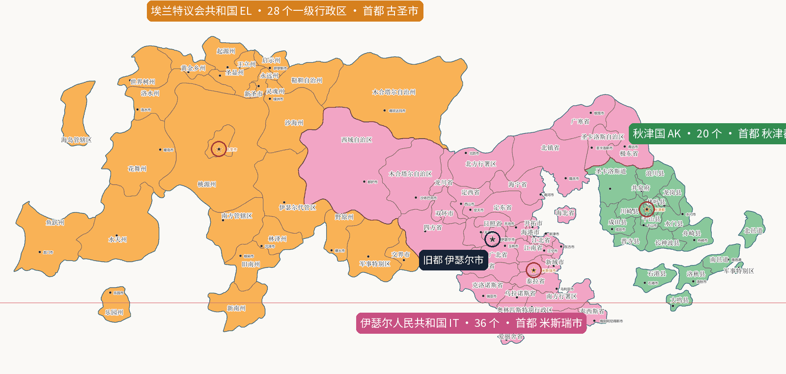

# 03 · 读懂三国的行政层级

**目标**：弄清三个国家、84 个一级行政区与驻地城市的上下级关系，学会用属性面板检查任意一级。

*伊瑟尔三国行政详图：埃兰特议会共和国 28 个、伊瑟尔人民共和国 36 个、秋津国 20 个一级行政区。红圈为三国首都，黑圈为旧都伊瑟尔市。*

## 步骤

1. **打开属性面板**

   选中伊瑟尔人民共和国，点卡片或工具条上的「属性」。右侧出现属性面板，「国家」页列出它的下辖行政区。再点一次「属性」关闭面板。

2. **核对三国规模**

   依次查找三国：伊瑟尔人民共和国有 36 个一级行政区，首都米斯瑞市；埃兰特议会共和国有 28 个，首都古圣市；秋津国有 20 个都、府、县、道，首都秋津都。

3. **比较不同的区划名称**

   伊瑟尔用省、自治区、行署区和直辖的市；埃兰特用州、自治州和管辖区；秋津用都、府、县、道。名称和范围都是可编辑的设定。

4. **看一块飞地**

   古圣市是埃兰特首都所在的辖区，四周都是桃源州。选中古圣市，再选中桃源州，比较两者的面积和边界。

5. **看旧南州**

   埃兰特的旧南州在参考图中是留白区域，制图时并入了埃兰特。选中它，确认卡片显示「下级地区」，属性面板中的上级是埃兰特议会共和国。

6. **检查驻地落在辖区内**

   选中任意城市，例如秋津都，卡片显示「城市」。属性面板中它的上级应是对应的一级行政区。每个一级行政区都有一个驻地城市。

## 验收

能说出三国各自的首都和一级行政区数量；选中省、州或县时，卡片显示「下级地区」，城市显示「城市」。

## 遇到问题

属性面板太窄时，拖动面板左边缘调整宽度。选中卡片挡住地图时，点「取消选择」或按 Ctrl+Shift+A。

---

[← 查找地点，控制视角](02-find.md) · [目录](../README.md) · [用领土画笔改变归属 →](04-territory.md)
