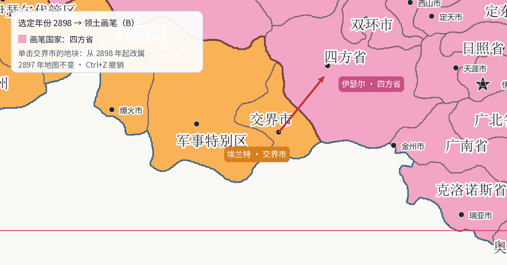

# 04 · 用领土画笔改变归属

**目标**：在指定年份把埃兰特的交界市划给伊瑟尔的四方省，同时保证 2897 年的地图不变。

*示意：2898 年起，交界市从埃兰特划归伊瑟尔四方省。工程本身没有这次变化，需要按本章步骤添加。*

## 步骤

1. **选定年份**

   工程打开时已在 2897 年。按 Ctrl+T 可开关时间轴。在时间轴上把年份改成 2898。选定年份后，修改从这一年起生效，更早的年份保持原样。

2. **把四方省设为画笔**

   按 Ctrl+F 查找「四方省」，回车后在底部卡片点「设为画笔国家」。画笔可以是国家，也可以是一个下级地区。

3. **选择领土画笔**

   点工具条上的画笔图标或按 B。地图上方只显示这个工具的常用选项：「返回选择」「画笔国家：四方省」和「单击填满整片」。点画笔国家可以换成其他国家，或新建一个国家作为画笔。需要更多选项时点「全部选项」。

4. **点交界市**

   放大到埃兰特与伊瑟尔交界的南部，左键单击交界市的地块。右键单击会取消该地块的归属；按住 Shift 单击会把相连的一整片归属相同的土地一起分配。

5. **对比前后年份**

   按 Shift+PageUp 回到 2897 年，交界市仍属埃兰特；按 Shift+PageDown 回到 2898 年，它已属伊瑟尔。

6. **撤销与重做**

   不满意时按 Ctrl+Z 撤销，按 Ctrl+Y 重做。鼠标停在工具条的「撤销」上，提示里会写出这一步的名称。

## 验收

2898 年交界市显示为伊瑟尔的颜色，属性面板中上级为四方省；2897 年仍为埃兰特的橙色。

## 遇到问题

单击后没有变化时，确认画笔国家已经设置，并且点的是陆地。没有选年份时修改会作用于所有年份，有历史的地块会拒绝这种修改。

---

[← 读懂三国的行政层级](03-hierarchy.md) · [目录](../README.md) · [切分、重画与合并边界 →](05-borders.md)
