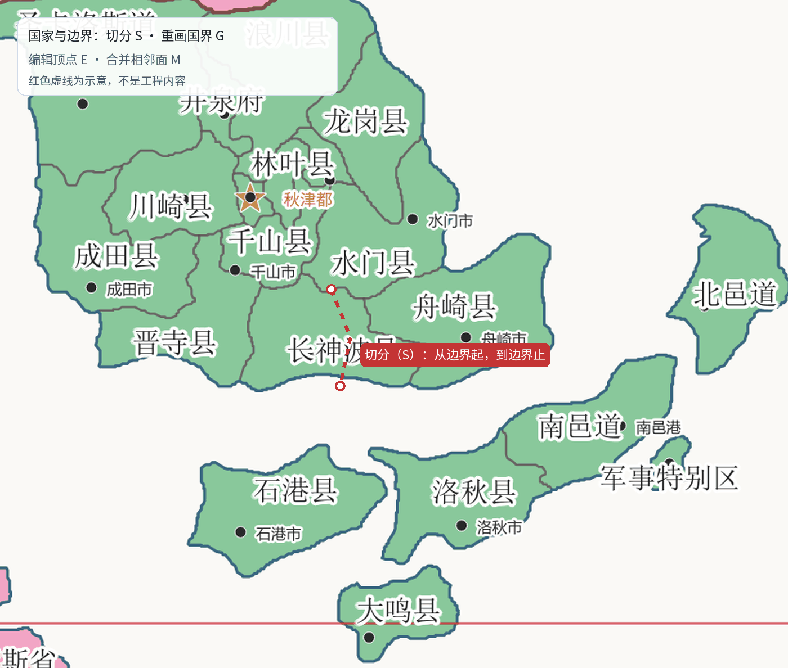

# 05 · 切分、重画与合并边界

**目标**：在秋津国内部练习切分、重画国界、编辑顶点与合并，理解共享边界：一条边只存一次，两侧一起变化。

*示意：在长神波县内从边界画到海岸，把一个县切成两块。红色虚线不是工程内容。*

## 步骤

1. **打开绘制菜单**

   点工具条最左侧的「绘制」。菜单按任务分为四组：地形与水系、国家与边界、地点与标注、整体与参考。每个格子写着名称和快捷键，正在使用的工具会高亮。

2. **切分一个县**

   在「国家与边界」中选「切分 / 画边界」（S）。从长神波县与千山县的边界上开始，单击几个点穿过县内，最后落在南边的海岸上，一块地切成两块。创作工作室默认用「自然」笔触，新边界带有自然的起伏；需要直线时，在上方工具栏的「线条」中选「原样」。专业界面保留自己的设置。

3. **把一半划出去**

   按 V 单击东侧相邻的舟崎县，在底部卡片点「设为画笔国家」。再按 B，单击刚切出的东半块，它从当前年份起归属舟崎县。

4. **重画一段国界**

   选「重画国界」（G），从秋津国与伊瑟尔之间的边界上出发，画出新的走向，再落回边界。新旧边界之间的土地归对侧所有，这也是一次领土变化。

5. **移动共享顶点**

   选「编辑顶点」（E），拖动两县之间边界上的一个顶点，两侧的县同时改变形状。右键删除顶点，在边上拖动可以插入新顶点。

6. **合并相邻面**

   选「合并相邻面」（M），依次单击切开的两块，删除它们之间的边界。完成后点工具栏最前面的「返回选择」或按 V。

## 验收

切分后两块地都能单独选中；移动顶点时两侧同时更新；合并后中间的边界消失。

## 遇到问题

切分要求起点和终点都在边界上，靠近边界时会自动吸附，按住 Ctrl 可临时关闭吸附。按 Esc 放弃画到一半的线，Backspace 撤回上一个点。

---

[← 用领土画笔改变归属](04-territory.md) · [目录](../README.md) · [河流、线路与城市 →](06-rivers.md)
