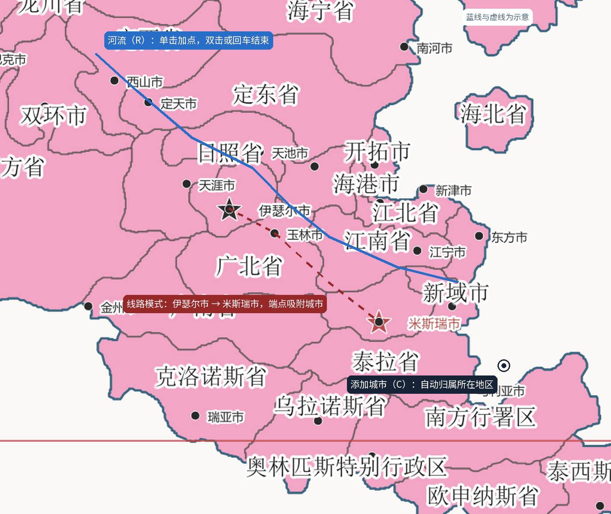

# 06 · 河流、线路与城市

**目标**：为伊瑟尔腹地画一条河，在旧都与首都之间连一条道路，并在合适的位置添加城市。

*示意：蓝线为新河流，虚线为伊瑟尔市到米斯瑞市的道路。工程本身不含这两条线。*

## 步骤

1. **画一条河**

   点工具条的河流图标或按 R。从龙川省北部开始单击加点，沿定东省、日照省一直画到新域市附近的海岸，双击或按回车结束。

2. **切换到线路**

   在工具栏把「河流」改成「线路」。线路用于道路、商路、航线和行军路线，所有年份相同。

3. **连接两座城市**

   从伊瑟尔市开始，经过玉林市，画到米斯瑞市。线路的端点会吸附到城市上；从已有线的端点开始画会延长那条线。

4. **添加城市**

   按 C，在泰拉省东部单击空白处添加城市。城市会自动归属所在的地区。单击城市可以选中，拖动可以移动，右键可以删除。

5. **给新要素命名**

   按 V 回到选择工具，单击刚画的河流和城市，在属性面板中填写名称，例如「伊川」和「东望市」。

6. **自动生成道路**

   需要成批的道路时，用「更多… → 所有命令 → 工具 → 道路与旅行…」。它在城市之间生成道路网，预览后才应用，还能查两城之间的旅行天数。

## 验收

河流和道路都能单独选中；新城市的卡片显示「城市」，属性面板中的上级是泰拉省。

## 遇到问题

画线时点被吸附到别的线上，说明靠得太近，按住 Ctrl 再点。线画错了先按 Esc 放弃，画好后可用编辑顶点修改。

---

[← 切分、重画与合并边界](05-borders.md) · [目录](../README.md) · [地图文字、符号与像素标志 →](07-marks.md)
