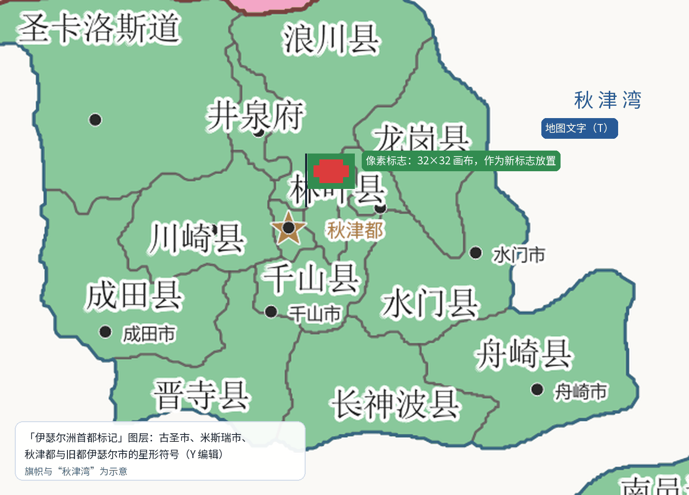

# 07 · 地图文字、符号与像素标志

**目标**：在秋津国附近加一处海湾名称，为秋津都放置自绘的像素旗帜，并整理首都符号所在的图层。

*示意：「秋津湾」与绿红旗帜为练习内容。星形符号来自工程的「伊瑟尔洲首都标记」图层。*

## 步骤

1. **添加地图文字**

   按 T 选择标注工具，在秋津国东侧海面双击，输入「秋津湾」。右侧的工具面板可以调整字号、字距和样式。

2. **放置符号**

   按 Y 选择地图符号，在右侧的工具面板选择种类，例如港口，再单击南邑港旁边的海岸。符号可以命名，也可以只在某段年份显示。

3. **画一面像素旗帜**

   点「绘制 → 地点与标注 → 彩色像素画笔…」。在 32×32 的画布上画出旗帜，右键可以吸取颜色，橡皮把像素还原为透明。

4. **放到地图上**

   点「作为新标志放置」，再单击秋津都旁边的空白处。在符号面板中调整大小，并把名称写成「秋津国旗」。

5. **查看首都标记图层**

   打开属性面板的「图层」页，找到「伊瑟尔洲首都标记」，里面是古圣市、米斯瑞市、秋津都和旧都伊瑟尔市的星形符号。可以隐藏、锁定或调整不透明度。

6. **统一外观**

   选中一个符号，用「更多… → 所有命令 → 对象 → 复制样式」，再选中其他符号「粘贴样式」，或者用吸管工具（I）。

## 验收

「秋津湾」在海面上显示；像素旗帜随工程保存，并在导出的 PNG、SVG 和 PDF 中出现；隐藏首都标记图层后四个星形一起消失。

## 遇到问题

文字不显示时，检查图层是否被隐藏，或是否放在了被锁定的图层里。像素标志的画布可以设为 1–128 像素见方，缩小画布也可以撤销。

---

[← 河流、线路与城市](06-rivers.md) · [目录](../README.md) · [时间轴、事件与外交 →](08-history.md)
