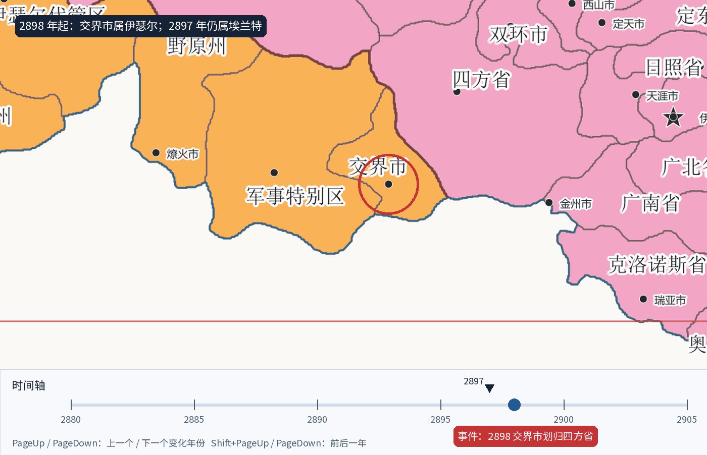

# 08 · 时间轴、事件与外交

**目标**：把第四章的领土变化写成一个事件，在历史页回放它，并在外交关系中记录三国之间的协约。

*示意：时间轴上 2898 年的事件标记与交界市的归属变化。时间轴外观为示意。*

## 步骤

1. **切到历史页**

   点顶部的「历史」。地图上方出现「事件时间线…」「时间播放与视频」「外交关系…」「保存点与自动保存…」，底部始终显示时间轴。

2. **新建事件**

   点「事件时间线…」，新建事件「交界市划归」，年份填 2898，写一段说明，例如「埃兰特与伊瑟尔勘定南部边界」。事件会显示为时间轴上的标记。

3. **在年份之间跳转**

   按 PageUp 和 PageDown 在有变化的年份之间跳转，按 Shift+PageUp 和 Shift+PageDown 前后移动一年。

4. **记录一份协约**

   点「外交关系…」，添加伊瑟尔人民共和国与秋津国之间的协约，设定生效年份，并关联刚才的事件。

5. **回放变化**

   点「时间播放与视频」，设置年份间隔和速度，播放 2895 至 2900 年。需要视频时可以导出 MP4。

6. **查看撤销记录**

   点「更多… → 历史记录」。列表中每一步都有名称，单击其中一步可直接回到那一步之后的状态。

## 验收

时间轴上 2898 年有事件标记；跳到 2897 年和 2898 年，交界市的归属不同；外交关系中能按年份查到协约。

## 遇到问题

历史页和时间轴只改变查看的年份，不会修改地图。事件不会自动改变归属，归属要用领土画笔等工具按年份修改。

---

[← 地图文字、符号与像素标志](07-marks.md) · [目录](../README.md) · [数据表与专题图 →](09-data.md)
