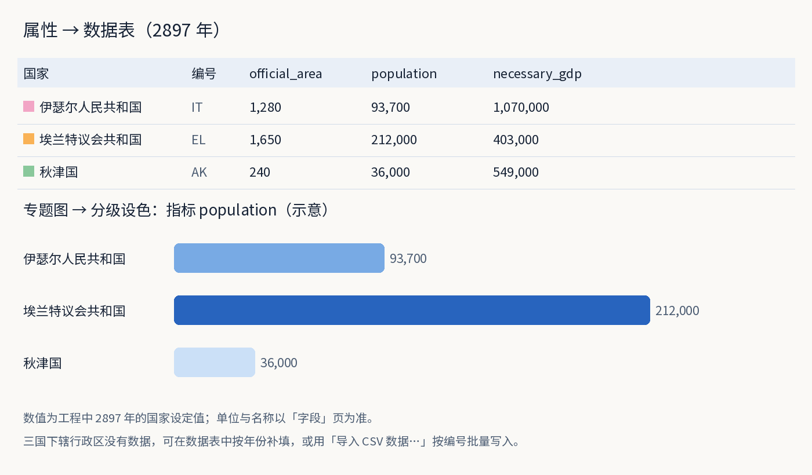

# 09 · 数据表与专题图

**目标**：查看三国在 2897 年的面积、人口和必要 GDP，用人口做一张分级设色专题图，并为行政区补充数据。

*表中数值为工程内的国家设定值，柱状图为分级示意。单位以「字段」页为准。*

## 步骤

1. **打开数据表**

   打开属性面板，切到「数据表」页。三国各有 official_area、population 和 necessary_gdp 三个设定值，都记录在 2897 年。

2. **查看字段定义**

   切到「字段」页，查看每个字段的名称、单位和类型。可以新建字段，也可以写派生指标，例如人口除以面积。

3. **比较三国**

   在数据表中比较：埃兰特人口最多，伊瑟尔必要 GDP 最高，秋津面积最小、人均产出较高。

4. **做专题图**

   切到「专题图」页，选「分级设色」，指标选 population，选择分级方法和色带。图例会随设置更新。

5. **补填行政区数据**

   三国的下辖行政区还没有数值。在数据表中开启按年份编辑，为秋津国的几个县填写 2897 年人口，或用「所有命令 → 文件 → 导入 CSV 数据…」按编号批量写入。

6. **回到政治地图**

   专题图做完后切回「政治地图」，地图重新按国家着色。专题设置会随工程保存。

## 验收

专题图中三国按人口分出不同深浅；补填后的县在数据表中显示 2897 年的数值。

## 遇到问题

导入 CSV 时用 code 列匹配编号，找不到 code 时用 name 列；未匹配的行会在状态栏列出。

---

[← 时间轴、事件与外交](08-history.md) · [目录](../README.md) · [世界资料与独立画板 →](10-library.md)
