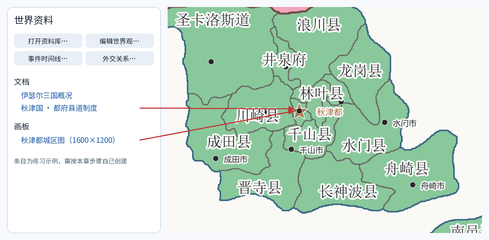

# 10 · 世界资料与独立画板

**目标**：为伊瑟尔三国写一篇概况文档，与地图上的国家关联，再为秋津都建一张城区画板，并能在它们之间来回跳转。

*示意：文档与画板为练习内容，箭头表示与地图对象的关联。*

## 步骤

1. **打开世界资料页**

   点顶部的「世界资料」。页面上方有「打开资料库…」「编辑世界观…」「事件时间线…」「外交关系…」，下方列出工程里的文档和三维模型。

2. **新建关联文档**

   回到地图页选中伊瑟尔人民共和国，再打开「打开资料库…」，选「新建关联文档」，标题写「伊瑟尔三国概况」。正文可以用标题、列表和表格。

3. **插入内部链接**

   在文档中用「内部链接」指向秋津国、事件「交界市划归」或其他文档。阅读模式下点击即可跳转。

4. **新建城区画板**

   点「画板 → 新建空白画板」，得到 1600×1200 的白色画布并直接进入编辑。在资料库的画板详情中把它命名为「秋津都城区图」，再用已经学过的工具画出街区和地标。

5. **在画板之间切换**

   点「画板」，列表中列出工程里的所有画板，单击即可切换。也可以按 Ctrl+F 输入画板或文档的名称。

6. **关联到秋津都**

   在资料库中把城区画板关联到秋津都。之后用选择工具双击秋津都，就能进入这张画板。

## 验收

查找「概况」能直接打开文档；双击秋津都能进入城区画板；点「画板」能回到主地图。

## 遇到问题

独立画板使用像素坐标，没有地理陆块，所以整体移动陆块、气候、星图等功能在画板中不可用。解除链接只删除关系，不删除文档或画板。

---

[← 数据表与专题图](09-data.md) · [目录](../README.md) · [保存点、版式与导出 →](11-export.md)
