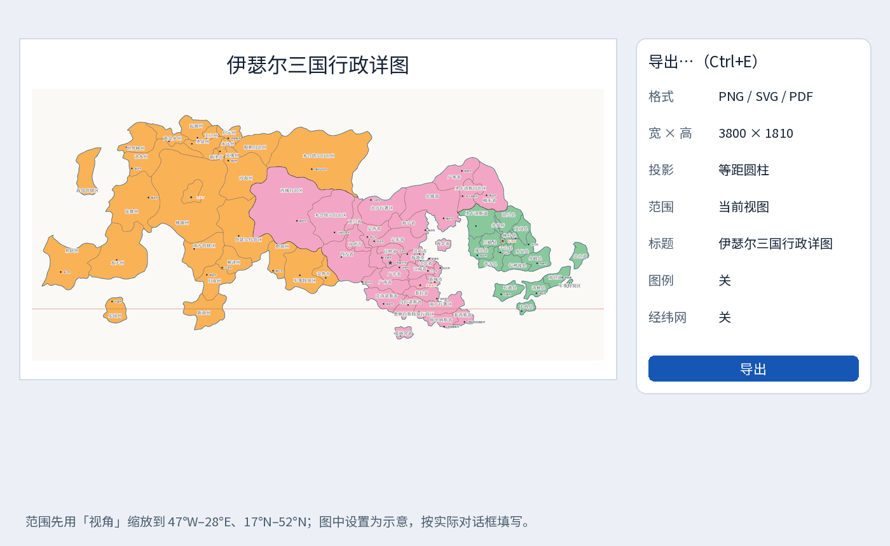

# 11 · 保存点、版式与导出

**目标**：在交付前设置保存点，复核地图，再导出一张与工程配图同范围的伊瑟尔三国行政详图。

*示意：导出范围为 47°W–28°E、17°N–52°N，与工程目录中的「伊瑟尔三国行政详图」相同。对话框为示意。*

## 步骤

1. **设置保存点**

   点「更多… → 保存点与自动保存…」，为当前状态创建保存点「三国练习 · 导出前」。之后可以从这里恢复，当前的 .atlas 文件不受影响。

2. **校验拓扑**

   用「更多… → 所有命令 → 编辑 → 校验拓扑」检查边界。切分和合并较多时，可以先执行「整理地块」。

3. **确定导出范围**

   按 Home，再把视角缩放到伊瑟尔洲，使左右大约到 47°W 和 28°E，上下大约到 52°N 和 17°N。

4. **设置导出**

   点工具条的「导出…」或按 Ctrl+E。选择 PNG、SVG 或 PDF，投影选等距圆柱，范围选当前视图，填写标题「伊瑟尔三国行政详图」，按需要开关图例和经纬网。

5. **用版式视图调整**

   需要排版时，用「所有命令 → 文件 → 版式视图…」拖动标题、图例、比例尺和指北针，所见即所得。

6. **保存工程**

   按 Ctrl+S 保存练习副本。顶部的「保存」变为「已保存」，工程名后的圆点消失。

## 验收

导出的图片包含三国、行政区名称和北回归线；用 Atlas Forge 重新打开练习副本，第四章至第十章的修改都在。

## 遇到问题

导出文字缺字时，确认使用的是随附的 Noto Sans SC 字体。拥挤的地图上，国名优先于河流和线路名称，后者会沿线让位或省略。

---

[← 世界资料与独立画板](10-library.md) · [目录](../README.md)
